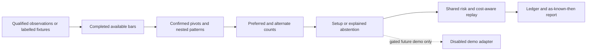

# Fuller Elliott-wave strategy — proposed implementation plan

Prepared 13 November 2026 (Africa/Johannesburg). **Approved by the user: “proceed thoroughly”. Implementation in progress.**

Implementation evidence and outstanding acceptance work are tracked in
[144 implementation status](ELLIOTT-EXPANSION-144-RESULTS.md). Approval does not
mean that all stages have been implemented or validated.

This document is the reviewable plan the user requested before implementation.
Writing it does not implement or activate a strategy, reopen a data source, change
an existing experiment, authorize collection dates, or enable orders. On approval,
the implementation will follow this scope. Material changes to the economic rules
will be documented as changes to the agreed plan before they are used.

## 1. Outcome and scope

Build an independently specified, substantially fuller Elliott-wave research
system: nested pattern recognition, competing counts, explicit decisions, realistic
cost-aware simulation, and charts showing what was known at each decision. It must
be possible to explain both a trade and an abstention from recorded inputs.

The friend's rules are optional comparison evidence. We do not need them to build
our own version. We cannot claim to reproduce his decisions without them.

"Fuller" means the practical pattern catalogue in section 4, with bounded nesting
and explicit unresolved states. It does not mean infinite wave degrees, a unique
true count, every disputed interpretation, or a profitable strategy by definition.
The first trading policy uses two continuation setups; recognizing a pattern does
not automatically authorize a trade in it.

Research and demo only. No real-money mode or toggle; no contest accounts;
automated orders remain disabled by default. No martingale, averaging down,
recovery sizing, paid services, broker-account creation, or changes to Skilved.
Canonical source stays in this repository. Any later Windows artifacts use a
separate owned directory and do not replace unrelated EAs or terminal settings.

## 2. What exists, and what this replaces

- [124](ELLIOTT-WAVES-124-PROTOCOL.md) is a daily three-close-swing hypothesis with
  a 1% impulse filter, 38.2–61.8% retracement band, breakout and daily trend gate.
  It is not a full impulse/correction parser.
- [125](ELLIOTT-EXECUTION-125-PROTOCOL.md) adds invented quote accounting, structural
  stops, costs and restart checks. [126](ELLIOTT-COMPARISON-126-RESULTS.md) compares
  invented paths. Neither establishes market performance.
- Their public schemas are deliberately invented-only. Their manifests and old
  results stay frozen. Real data will never be relabelled as invented.
- The existing execution opportunity key is a daily feature/session. The new
  strategy needs a canonical setup key, otherwise valid same-day H1 opportunities
  could be suppressed or duplicated after a recount.
- The current collector produced [zero qualified H1 bars](COVERAGE-137-RESULTS.md).
  [Latest supervision work](NATIVE-SUPERVISION-143-RESULTS.md) is engineering evidence,
  not a new price dataset or strategy result.

Implement a separate versioned path, tentatively `EW_FULL_V1`, leaving 117–126 and
their inputs/results unchanged. Reuse independently checked arithmetic where it
fits; do not force the new strategy through incompatible frozen wrappers.

## 3. Proposed defaults for approval

All numerical choices here are research design choices, not universal Elliott
rules, optimized parameters, or recommendations for a real-money account.

| Decision | Proposed v1 choice |
| --- | --- |
| Instrument/accounting | EURUSD, USD accounting; other instruments need their own contract/data declaration |
| Chart timeframes | D1 context, H4 structure, H1 setup and trigger; no incomplete higher-timeframe candle |
| Wave degrees | Three nested operational swing scales per timeframe; a timeframe is not itself a wave degree |
| Price basis for counts | Observed midpoint OHLC; execution always uses observed bid/ask, never midpoint fills |
| Pivot scales | Strict centred extrema with 2, 4 and 8 completed bars on each side; delayed confirmation recorded |
| Minimum warmup | 253 complete eligible bars on each of D1/H4/H1, plus all history needed by an active pattern |
| Tradable families | Prospective wave 3 after wave 2; prospective wave 5 after wave 4 |
| Context | Both H4 and D1 must support the proposed next-leg direction; unresolved/conflicting context abstains |
| Entry | Subsequent H1 close crossing the prior wave-1/wave-3 extreme, then the first eligible later quote |
| Protection | Structural correction extreme plus fixed buffer; original stop never widened |
| Target/time exit | Fixed 2R from actual entry and original stop; 72 elapsed-hour time exit on next executable quote |
| Risk ceilings | Estimated entry loss <=0.25% executable equity; one aggregate reservation/position; 1% daily loss entry pause |
| Volume | Floor to admissible lot step; skip below minimum; no rounding up to make a trade possible |
| Research account | Fresh USD10,000 for each comparison cell; this is not a demonstrated USD20 strategy |
| Entries | One attempt per canonical setup; no pyramiding, same-quote reentry, reversal or averaging down |
| Search/trial scope | Fixed grammar and ranking; no parameter grid, best-month selection or hidden retries |
| Native execution | Separate disabled demo adapter, only after historical/shadow gates; no automatic activation |

These defaults give us a complete independent starting policy. The friend may use
different instruments, timeframes or earlier entries; those differences will be
recorded instead of silently changing v1.

## 4. Pattern catalogue and rulebook

Before coding the parser, write a compact machine-readable rulebook. Each rule has
an ID, family/location, source, status (`structural_rule`, `guideline`, or
`project_convention`) and positive/negative examples. Hard structural violations
cannot be offset by a good Fibonacci ratio or a high ranking score.

| Family | Recognition in v1 | Trading use |
| --- | --- | --- |
| Ordinary impulse | Five legs; 5–3–5–3–5 child grammar; nested motive/corrective children; bullish and bearish mirrors | Wave-3 and wave-5 setup context |
| Extensions | Nested impulse extensions within the finite depth; preserve labels and competing placements | Allowed when necessary children are resolved |
| Truncated fifth | Completed motive fifth that fails to exceed the third's extreme; never inferred merely from an unfinished fifth | Completed-pattern/context evidence; no special truncation bet |
| Single zigzag | ABC with 5–3–5 children and a corrective B | Eligible wave-2/wave-4 correction |
| Double/triple zigzag | W–X–Y / W–X–Y–X–Z with explicit corrective connectors | Eligible completed correction within depth limits |
| Regular/expanded/running flat | ABC with 3–3–5 children and separately versioned geometric classifications | Eligible completed correction when subdivisions resolve |
| Contracting/barrier/running triangles | ABCDE with corrective children, location restrictions and declared boundary geometry | Wave-4 context; never a standalone wave-2 triangle |
| Expanding triangle | Explicit expanding geometry and valid parent location | Recognition/reporting only in v1 |
| Leading diagonal | Named 5–3–5–3–5 and 3–3–3–3–3 interpretations, restricted to wave 1 or zigzag A | Contracting 5–3–5–3–5 profile may support a wave-3 setup; other profiles are non-actionable alternatives |
| Ending diagonal | Contracting 3–3–3–3–3 at wave 5 or terminal C, including overlap | May complete a correction; no direct diagonal-reversal setup |
| Expanding/disputed diagonal | Named provisional form; no exceptions invented to rescue shortest-third violations | Observation only |
| Double/triple sideways combination | Bounded corrective components and X connectors, distinguished from multiple zigzags | Double combination can complete a correction; triple sideways combinations observation only |

A family is not marked implemented merely because a label is displayed. Its child
grammar, valid parent locations, boundaries, incomplete state, invalidations and
mirror tests must all exist. Observation-only patterns still require recognition
tests and must be visible as alternatives that can block a conflicting trade.

For ordinary impulses, enforce the wave-2 origin boundary, wave-3 progression and
shortest-third constraint, and wave-4 non-overlap with wave 1. Check each constraint
only when its necessary legs exist: a future fifth cannot validate an earlier
wave-3 decision. No FX overlap exception is silently borrowed from futures.
[Impulse](https://www.elliottwave.com/waveopedia/impulse/) and
[motive-wave definitions](https://www.elliottwave.com/waveopedia/motive-waves/).

For shortest-third comparisons use absolute proportional price movement
`abs(end-start)/start` on positive prices. Fibonacci retracement/extension ratios
use absolute price distances. These are explicit measurement conventions; use
decimal/rational arithmetic and reported price precision, not binary-float epsilons.
Reject a third strictly shorter than both first and fifth; equality is allowed.
For tradable ordinary impulses, touching the wave-1 territory boundary with wave 4
is conservatively rejected. Midpoint geometry uses half-tick precision where needed;
orders use the actual executable price increment. Neither rounding nor tolerance
may turn an observed structural violation into a valid count.

Flats require numerical conventions because the source uses qualitative terms.
Proposed regular-flat B/A band is 0.90–1.00 inclusive; expanded/running B exceeds
the origin by at least one price quantum, with C respectively beyond/short of A's
end. Regular-flat C must exceed A's end by at least one quantum; no separate
"slightly beyond" upper bound is imposed in this project profile. C exactly at
A's end remains boundary-ambiguous. Ratios outside the regular
band do not get renamed to force a match. These thresholds are our conventions,
not claims that the source prescribes 90%.
[Flat definitions](https://www.elliottwave.com/waveopedia/flats/).

Triangle boundaries use A–C and B–D lines evaluated in observed trading-bar index
space. Declare contracting/expanding widths and a barrier tolerance of 5% of the
formation's largest leg. E may undershoot/overshoot the A–C line; that alone is not
a universal invalidation. Require correct parent position and overall corrective
direction. Standalone wave-2 triangles are rejected; a triangle inside a permitted
combination is distinguished from one occupying all of wave 2.
[Triangle definitions](https://www.elliottwave.com/waveopedia/triangles/).

Leading diagonal subdivisions are not settled uniformly even in the chosen source.
Keep their profiles separate. Ending diagonals require corrective children and
their proper terminal location. Do not relax an ordinary impulse to allow overlap;
construct a distinct diagonal candidate and test its own complete grammar.
[Diagonal definitions](https://www.elliottwave.com/waveopedia/elliott-wave-pattern-diagonals/).

Extensions and truncations preserve internal grammar. Do not require exactly one
extended actionary wave, and do not call an unresolved fifth a truncation.
[Extension](https://www.elliottwave.com/waveopedia/extension/) and
[truncation](https://www.elliottwave.com/waveopedia/truncation/).

In v1's strict sideways-combination profile, components are flats/zigzags with at
most one zigzag, and an optional triangle only in the final component. X is
corrective. This finite profile is an explicit project restriction, not a proof
that other interpretations cannot occur. Multiple zigzags use their separate
grammar. Unsupported nesting remains visible rather than being forced into ABC.
[Combinations](https://www.elliottwave.com/waveopedia/combinations/) and
[zigzags](https://www.elliottwave.com/waveopedia/zigzags/).

## 5. Causal bars, pivots and nested structures

1. Every input carries original sequence/lineage, observation bounds, availability
   bounds and its session/contract/cost context. Unknown clock offsets stay unknown.
   Aggregate only completed, qualified bars. Daily session boundaries and H4/H1
   alignment are declared from the admitted source/calendar, not guessed from a
   broker server label. Partial scheduled sessions require explicit coverage rules.
2. A radius-r high is strictly higher than the other highs in its `2r+1` completed
   bar window; lows are mirrored. Equal extrema do not confirm. A pivot occurring
   at bar i is available only when bar i+r and all dependencies are available.
   Persist occurrence and confirmation separately. In invented runs the same
   contract is exercised with invented times, labelled as such.
3. A bar that qualifies as both a high and a low has unresolved within-bar order;
   neither becomes an ordered pivot unless qualified finer observations establish
   that order. Do not choose the direction that produces the better trade.
4. Preserve every confirmation event immutably. In the current alternating view,
   a later same-kind, more-extreme pivot supersedes the previous interpretation;
   it does not rewrite earlier decisions. Less-extreme same-kind turns remain in
   the journal but do not extend that alternating view.
5. Radius-8/4/2 extrema give coarse/middle/fine operational scales. Parent-child
   parses must share endpoints, ordered contained spans and compatible direction.
   Incompatible alternating views remain unresolved; never force a child match.
   Base swing segments are explicit finite-resolution leaves, not proof of
   unobserved subwaves. Trading requires the ended setup legs to have a resolved
   child grammar at least one level below the setup's scale.
6. Enumerate the middle/coarse H1 setup scales as one fixed candidate, deduplicating
   common economic setups. H4 and D1 parsers supply independent context. Different
   timeframes are not automatically assigned different Elliott degrees.
7. Initial bounds: last 256 confirmed pivots per scale/timeframe, nesting depth
   three, 128 live candidates per scale/timeframe and 4,096 parser expansions per
   update. Exhausting a bound records `search_incomplete` and blocks new entries
   for that snapshot. Never call a truncated search an exhaustive best count.
   Memory bounds cannot discard held-position or consumed-setup safety state.

The engine processes received events in their observed order. Bounded timestamp
uncertainty must fit the relevant session/bar and freshness requirements. If
ordering remains material and unresolved, reject that decision/evaluation instead
of sorting events using future knowledge. Completed high-timeframe bars cannot
be published early merely because their nominal end time passed.

## 6. Which count? Explicit selection and abstention

Each count contains family, degree/scale, anchors/children, rule results, current
stage, invalidation levels, occurrence/availability, revision and provenance.
States distinguish incomplete, valid-at-current-prefix, complete, invalidated,
unsupported and insufficient-resolution. A valid partial count is not a confirmed
future outcome.

Resolve context top-down without self-reference: rank D1 using its local evidence
only, then H4 using the already available D1 result, then H1 using both. Parent
agreement in the ranking below is therefore inapplicable/zero for D1, 0–1 for H4,
and 0–2 for H1. Compare candidates addressing the same active terminal window and
setup phase; do not compare an old completed pattern against an unrelated new one.
Only already-required past evidence counts as unresolved; an intentionally future
wave is not a missing historical requirement.

Each higher-timeframe competitive set emits a directional set. A resolved wave-2
or wave-4 correction ready for its next motive leg, or a still-valid active wave-3
or wave-5 motive leg, contributes that motive direction. A completed corrective
pattern contributes the prior motive direction only if its parent location is
resolved. Unfinished corrections, a finished impulse awaiting interpretation,
terminal diagonals, insufficient subdivisions and unknown parent locations emit
unresolved, rather than a guessed direction. Any unresolved member, or a union
containing both directions, makes that context unusable for entry. H1 requires
singleton H4 and D1 sets matching its proposed side.

Reject structural violations first. For the remaining candidates, use a frozen
lexicographic ranking, in this order:

1. Fraction of already-ended required legs with resolved child grammar.
2. Number of agreeing available parent contexts (H4 and D1, 0–2).
3. Fewer unresolved requirements and fewer rare/observation-only forms.
4. More applicable Fibonacci guideline matches, then smaller total ratio error.
5. Applicable alternation, then channel conformity.
6. Fewer connector/components; canonical anchor IDs only break a display tie.

Fibonacci guideline targets: retracements {0.382, 0.500, 0.618, 0.786}; actionary
length ratios {0.618, 1.000, 1.618, 2.618}. A match is within 0.05 absolute ratio
units. Use five fixed slots: wave-2/wave-1 retracement, wave-4/wave-3 retracement,
wave-3/wave-1 length, wave-5/wave-1 length, and C/A length. Only ended applicable
legs supply a ratio. Each missing/inapplicable slot contributes zero matches and
error 1; an observed slot contributes its match flag and the nearest-target
absolute error capped at 1. Rank by total matches then negative total error.
This defines a total tuple even for different pattern types; do not use pairwise
conditional comparisons that could create a non-transitive ordering.
Alternation means a resolved sharp versus sideways wave-2/wave-4 family pair;
unavailable wave 4 gives no evidence. Channel conformity means completed internal
bar extrema fit the parallel envelope through waves 1/3 and 2, widened by one price
quantum; it ranks only counts for which those anchors exist. These guidelines are
preferences, not hard Elliott definitions or calibrated probabilities.

The **competitive set** is all surviving candidates tied on the first three
ranking criteria for the current setup opportunity. Retain all within the declared
cap, displaying at least the preferred count and two alternatives. Entry requires:

- Full child resolution for the ended setup legs; both higher contexts agree.
- Every competitive actionable interpretation supports the same direction and
  setup family. A competitive unresolved/observation-only interpretation, opposed
  context or conflicting setup means abstain.
- No incomplete search, material event-order ambiguity or required-data gap.

Guidelines select the displayed preferred count; they cannot erase an equally
supported contradictory interpretation to manufacture permission. For agreeing
counts with different invalidations use the most conservative stop boundary
(lowest for longs, highest for shorts) and size to it. Keep every contributing
count in the signal provenance. A changed preference becomes a new timestamped
revision; no previous count snapshot or trade is retroactively replaced.

For an agreeing set, the consensus long breakout is the highest constituent
wave-1/wave-3 threshold (short: lowest), formation time is the latest constituent
availability, and expiry is the earliest constituent expiry. All constituents must
remain valid. A changed constituent set cancels the unsubmitted consensus and can
form a new revision only if the original economic opportunity is still unconsumed;
it never renews an old expiry or permits a trigger already passed at reformation.

Sources for guideline terminology:
[Fibonacci](https://www.elliottwave.com/waveopedia/fibonacci-relationships/),
[alternation](https://www.elliottwave.com/waveopedia/alternation/),
[channeling](https://www.elliottwave.com/waveopedia/channeling/), and
[alternate-count discussion](https://www.elliottwave.com/free/introduction-to-the-wave-principle/).
The ranking/abstention algorithm itself is our research proposal.

## 7. When does it act? Two precise entry setups

| Setup | What must already be observed | Long trigger | Initial long invalidation |
| --- | --- | --- | --- |
| EW3 | Resolved motive wave 1, resolved corrective wave 2, wave-1 origin intact; parent contexts support continuation | A subsequent completed H1 close crosses strictly above wave-1 high | Lowest observed price in the completed wave-2 correction |
| EW5 | Resolved waves 1–4 in an ordinary impulse; valid wave-4 grammar and no wave-1 overlap | A subsequent completed H1 close crosses strictly above wave-3 high | Lowest observed price in the completed wave-4 correction |

Mirror prices/inequalities for shorts. No direct wave-C, countertrend reversal,
unfinished diagonal, or discretionary intrabar entry in v1. Corrective families
still materially affect which EW3/EW5 setups are recognized and rejected.

- Formation is only after the required pivot/count confirmation. If price already
  closed beyond the trigger before or on that confirmation bar, discard the setup;
  do not buy retrospectively or chase a missed trigger.
- A crossing requires previous H1 close at/below and new close above the long
  trigger (short mirrored). Formation and crossing cannot be the same bar.
- Setup expires after 10 subsequent completed eligible H1 bars; bar 10 can trigger,
  bar 11 cannot. A required coverage break cancels unfilled setups, not held risk.
  This cancellation is immediate only for an unsubmitted local setup. A submitted
  order retains its reservation until cancellation or another terminal outcome is
  reconciled. Ambiguous acknowledgements and partial fills continue to occupy the
  shared risk slot.
- Structural invalidation takes precedence on an H1 bar that also crosses the
  trigger when order is unresolved. Invalidated setups cannot be revived by
  renaming wave labels.
- Signal becomes available after its latest dependency. The entry quote must be
  strictly later than the latest bound of signal availability plus declared latency;
  it must also arrive within 60 seconds of signal publication and before a new
  H1 decision supersedes it. The first eligible quote consumes the setup, including
  when holding, paused, below minimum volume or failing margin/geometry checks.
  Proposed hypothetical latency is 250 ms base and 1,000 ms adverse. Actual timing
  bounds, or explicitly conservative assumptions, must be frozen in the run
  manifest before returns. Missing actual latency is never silently zero and
  cannot establish broker execution quality from the hypothetical defaults.
- Default eligibility uses a <=2-second worst-case quote age and <=1.5-pip effective
  entry spread. Both are frozen research assumptions until source terms qualify.
  Missing a valid entry is an abstention, not permission to fill at the old close.
- A structural-price check is repeated immediately before reservation/fill. The
  setup key binds symbol, direction, EW3/EW5 setup type and source correction
  anchors across related count revisions/scales. "Type" does not mean a changing
  flat/zigzag/diagonal label. Equal source anchors and enclosing-scale aliases
  sharing the same terminal correction pivot belong to one persistent opportunity
  group. Group merges preserve the union of consumed state and earliest expiry;
  they cannot split into a fresh opportunity after a recount. A genuinely new
  confirmed correction terminal is required for a new economic setup. Only one
  attempt is allowed for each such group, across count labels and restarts.

In an EW5 setup, the known wave-1/wave-3 proportional lengths can impose a maximum
permitted fifth length. Reject an entry if its planned target would violate the
shortest-third rule. Do not label a prospective wave 3 as the longest or shortest
using an unobserved fifth.

## 8. Exits, costs, sizing and loss limits

At setup formation, freeze a buffer of `max(one tick, 0.10 * H1 ATR14)` using only
completed bars; ATR is the arithmetic mean of 14 true ranges with preceding closes.
Place long stop below the conservative correction low by that buffer; short above
the high. Round the initial stop outward to an allowed tick before sizing and
recheck the budget. Preserve the original levels after entry. No automatic break-even,
trailing stop, averaging down or widening after a recount in v1.

Compute R from actual modeled executable entry to the original stop. Nominal target
is entry +/- 2R, rounded toward entry to an allowed tick; report its actual R and
recheck the EW5 structural ceiling after rounding. Exit at stop, target, 72 elapsed
hours from fill, or declared dataset
boundary. A time exit while the venue is closed waits for the next eligible
executable quote; it does not invent a price. A changed preferred count alone does
not reverse or resize a held trade. Persist risk state even when feature inputs
become unavailable.

Entry spread, warmup, count-consensus and daily entry-pause gates never prevent
protective management of held exposure. Native close/cancel operations still
require actual DEMO mode, account continuity and owned-order reconciliation. When
prices or connectivity are unavailable, retain pending/unresolved exposure and
raise a halt/diagnostic; never manufacture a last-price exit or delete a position.

Use ask to buy and bid to sell; long liquidation/stop checks use bid, short uses
ask. Stops fill at the first observed breached executable quote with adverse
slippage, including gaps. Targets receive no favorable overshoot and require
observed executable reach. Do not infer missed intrabar fills from a later candle.
Unresolved order of target/stop touches produces a declared adverse bound or an
unavailable result, never an assumed win. Sparse observations cannot establish
true tick-level drawdown or complete stop paths; report observed values and gaps.

Risk budget is at most `0.0025 * positive executable equity`. Divide by per-lot
estimated loss to the structural stop, including entry/exit costs; also constrain
by free margin, lot limits and immediate liquidation headroom above the daily
pause floor. Floor to the actual volume step and recheck inequalities. For EURUSD
the initial hypothetical profiles use a 100,000-unit contract, 0.01 minimum/step,
1-lot cap and 30:1 leverage; admitted market runs require applicable actual terms.
At USD20, a 0.25% budget is USD0.05, so minimum lot/cost constraints may reject
every trade. We will report this rather than raise risk to reproduce USD350.

There is one shared reservation/position across all counts, scales and setup
families. No separate risk pot per wave label. A position held at quote arrival
prevents reentry on that quote even if it exits there.

Collect all eligible simultaneous setup groups before reservation. Opposing sides
abstain. For same-side groups reuse the frozen ranking without its final display-ID
tie-break; an unresolved economic tie abstains. Parser traversal/list order cannot
choose a trade. Once reserved, competing groups cannot obtain another risk slot.

The daily reference is prior eligible executable equity at the UTC-day boundary,
frozen before new-day financing and the first new-day gap; first day uses starting
equity. Charge those financing/gap effects to the new day's drawdown. Use the last
qualified mark immediately preceding the boundary, or the last scheduled-session
close when the qualified calendar establishes a closure. Declare that mark's age
and any interval with unobserved equity; do not claim an interpolated boundary
price. An unexplained coverage break or missing persisted reference disables new
entries for that day; a later recovered mark cannot create a forgiving reset.
Held-position handling continues. Equity at/below 99% of
the day reference latches an entry pause for that day, including floating losses
and costs. Same-day recovery and restart do not clear it. No new-day reset occurs
until a valid reference and position reconciliation exist. External cash flows in
demo require an explicit reconciliation event; they cannot silently reset losses.

Preserve the [117 comparison profiles](STRATEGY-EVIDENCE-117-PROTOCOL.md): base/adverse
commission USD7/10 per round-turn lot; slippage 0.2/0.5 pip per applicable fill;
financing USD3/4.50 long and USD1.50/2.25 short per lot at the declared rollover;
adverse spread floor 1.2 pips. These are hypotheses, not verified broker charges.
Use recorded bid/ask spreads and applicable rollover/calendar rules; count embedded
spread/slippage once. Actual commission, swaps, conversion and margin terms must
be supplied for broker-performance claims. Empty commission responses are unknown,
not zero. Contradictory actual terms require a new declared profile before returns.

Stops, entry-risk estimates and daily pauses are not guaranteed loss caps. Gaps,
slippage, outages and financing can exceed them. Report every such exceedance.

## 9. Implementation structure and reviewable outputs

Use a new small package such as `src/forex_demo_lab/elliott_full/`, one declarative
config, focused tests and one CLI. Suggested responsibilities:

| Module | Responsibility |
| --- | --- |
| `contracts.py`, `bars.py` | Distinct invented/qualified-market schemas; availability/session-aware D1/H4/H1 aggregation |
| `pivots.py`, `patterns.py` | Causal pivots, finite grammar and nested nodes with rule diagnostics |
| `counts.py` | Bounded alternatives, ranking, revisions and ambiguity |
| `setups.py` | EW3/EW5 state machine, economic setup identity, triggers, invalidation and expiry |
| `execution.py`, `risk.py` | Offline quote-to-ledger adapter, sizing, reservations, exits and financing |
| `replay.py`, `report.py` | Prefix checkpoints, reproducible runs, evidence labels and annotated charts |
| Separate demo boundary | Default-off native adapter; no broker submission import in the research package |

These names are proposed layout, not existing files. The authoring phase will
create one protocol/config declaration rather than proliferating a document for
every helper. Old strategies remain controls. New adapters must prove accounting
parity on preserved cases instead of modifying frozen daily implementations.

Produce a local HTML chart/replay viewer with a time cursor: only prices and
counts available by the cursor appear by default. Show provisional versus confirmed
pivots, preferred and alternate labels, formation/confirmation/entry times,
invalidation, stop/target, fills and every no-trade reason. A clearly labelled
retrospective view may show the completed chart without rewriting the earlier view.
Export a readable report plus structured JSON and CSV ledgers. No website hosting
or external analytics is needed.

Checkpoints bind input prefix, rule/config version, clock/context state, pivots,
all live counts, consumed setups, pending action, held protection, cash/financing
and loss latches. A corrupt or cross-version checkpoint is rejected. Deterministic
offline restart must match uninterrupted replay exactly. Native execution needs
broker reconciliation as well; a local hash is not proof of an order outcome.

## 10. Meaningful software verification

Test the actual new pipeline and ledger, not only isolated recognizer functions.

| Area | Required evidence |
| --- | --- |
| Pattern coverage | Valid/invalid/incomplete/ambiguous examples in both directions for every claimed family, parent location, child grammar and boundary |
| Causality | Mutating/appending future data leaves all earlier published counts, decisions, fills and equity unchanged; original pivot price cannot become a backdated entry |
| Timeframes | Unfinished/delayed H4/D1 data cannot affect H1; missing children block publication; closure/DST/session boundaries are explicit |
| Counts | Ties, contrary alternates, invalidation, observation-only competition, same-kind replacement, search overflow and insufficient resolution |
| Entry | Formation/trigger separation; expiry equality; invalidation before ambiguous breakout; latency, stale/wide quotes and missed opportunities |
| Sizing/positions | Floor lots, minimum-lot rejection, margin/headroom, one global pending/held position, concurrent competing signals |
| Stops/losses | Long/short gap overshoot, widened exit spread, financing, daily pause including open losses, no same-day recovery reset |
| Duplicates/restart | Replay before/after confirmation, signal, reserve, fill, stop, pause and finalization; conflicting duplicate rejection and consumed-setup persistence |
| Accounting | Independent rational reconstruction of cash, costs, fills, financing and observed equity; differential checks against retained 120/125 accounting cases |
| Native adapter | Actual REAL/CONTEST/unknown/change rejection; account check immediately before submission; ambiguous acknowledgement, partial fills, foreign positions and restart reconciliation |

Use deliberately constructed paths and bounded generated event sequences to
exercise safety properties. They establish implementation behaviour, not a win
rate. Keep both success and failure paths. Run targeted checks per slice and the
relevant integration/regression suites before completion. Do not repeatedly rerun
unchanged broad suites without a reason. No tests or implementation are part of
this planning-only change.

## 11. Market evidence: a separate, explicit gate

### Existing data boundaries

Preserve 2024 as already-seen development, 2025 as consumed/excluded, October 2026
as quarantined, and November–December 2026 as reserved/untouched. Older 2020–2023
inputs have unresolved qualification. Do not reopen closed provider routes, renew
the expired 136 capture, or assign fresh capture dates through this strategy plan.
No currently assigned dataset satisfies the proposed full study.

The inherited daily requirement is **253 prior complete sessions plus at least
24 calendar months of development and 24 of genuinely unseen validation**. The
separate 201-H1-bar adapter and 480/480-hour engineering pilot do not satisfy it.
For this multi-timeframe version all required D1/H4/H1 history must also qualify.
These are retained research/sample choices, not a theorem about statistical power.

### Admission and chronological study

Create one concise source/run manifest before returns. It freezes source hashes,
permitted dates, complete prior-trial history, timezone/DST/uncertainty evidence,
calendar and bar boundaries, coverage policy, quote availability/order, latency,
cost/contract/margin/financing evidence, rules/code hashes and exit endpoints.
No forward-filled missing sessions, guessed offsets or removal of bad periods
after seeing P&L. Missing evidence reports `UNAVAILABLE`, with reasons.

Compare four fixed complete strategies: EW_FULL_V1, unchanged EWPB_D124, unchanged
daily T12_D trend, and CASH. Each has two costs and two chronological partitions:
**16 declared cells**. Preserve earlier study declarations and disclose overlap;
these are correlated comparisons, not 16 independent discoveries. Use a new
qualified runner for the unchanged control rules, with parity fixtures proving
it reproduces those rules; do not loosen their old invented-only entry points.

Freeze v1 before development returns, run development once, then untouched
validation once with the same rules. Each cell starts with USD10,000 and no incoming
position. Prior prices may warm up a validation account, but development trades
and profits cannot carry across. Boundary exits require an actual eligible quote
inside the partition. Missing endpoints are unavailable; no later holdout quote
can close a development trade. No automated optimization or post-result wave-family
selection. A proposed revision remains a new trial and cannot reuse the holdout
as if it were untouched.

Report gross/net P&L, expectancy, wins/losses, payoff, costs, observed executable
drawdown, exposure, turnover, monthly/quarterly results, largest loss, breaches of
entry estimates, unavailable intervals and no-trade reasons. Compare benefit with
the old Elliott rule and simple trend while disclosing different risk/exposure.
Breakdowns by setup are descriptive, not permission to drop the losing setup.

Retain [117's descriptive screen](STRATEGY-EVIDENCE-117-PROTOCOL.md): positive net
profit and net expectancy under both validation cost profiles, adverse observed
drawdown <=5%, at least 50 closed validation trades and 24 monthly marks. Too few
observations is `INSUFFICIENT`; economic failure is `FAIL`; missing qualification
is `UNAVAILABLE`. Passing earns further research review, not a profitability
guarantee or automatic execution. Sparse sampling limits the meaning of drawdown.
No statistical-significance or probability claim without a separately frozen
inference method accounting for prior trials and dependence.

If actual historical fees cannot be established but price/time data qualify, one
additional **16-cell hypothetical-cost sensitivity batch** is permitted under its
own pre-return manifest and explicit label. It cannot satisfy the broker-performance
or demo gate, overwrite the qualified study, or silently repair 117. Thus the
maximum initial budget is 16 qualified cells plus 16 optional sensitivity cells;
any further batch/version is recorded before execution. Availability of suitable
data still controls whether either batch can run. Synthetic testing is not a
substitute for either batch.

The sensitivity batch can itself consume validation data. If its validation prices
or outcomes are inspected before the qualified study is fully frozen, those dates
cannot later serve as untouched qualified validation. Either jointly freeze all
complete comparisons before any outcomes and disclose their dependence, or reserve
a separate genuinely unseen validation interval for the later study. No newly
learned fees, rule changes or source repairs are silently fitted to an exposed
holdout and called independent validation.

At implementation start, publish a short source-feasibility status using existing
metadata only: what is eligible, what is unknown, and the smallest evidence needed.
Continue pure strategy work even if market admission is blocked. Do not let this
become an indefinite collector rewrite, and do not declare market validation done
when only the software is done. Four years of prospective waiting is not presumed;
qualified historical data could serve, but none is promised or assigned today.

## 12. Forward shadow and demo execution

After a qualified historical screen and review, freeze a bounded forward shadow
window, source, session calendar and unchanged rules before observing its prices.
Proposed operational sample: 60 scheduled market sessions with at least 20 closed
shadow trades, and zero unexplained duplicates, position mismatches, future-data
uses or missing required risk actions. Report net/cost/risk outcomes too. An
undersized sample stays insufficient at the end; do not opportunistically extend
the window to obtain a pass. A further window is a new declared study. This is an
operational gate, not independent proof of income.

The demo adapter can be built and fault-tested while disabled. Native submissions
are unavailable until the historical/shadow and operational guards pass and a
specific bounded demo run is explicitly enabled. Confirming this implementation
plan does not itself start an order-placing run.

Before every submission, including modifications/cancellations, check the actual
account type enum is DEMO, account continuity in memory, connection, current
contract/risk state and reconciliation. REAL, CONTEST, unknown or changed identity
blocks submission. A demo server name or synthetic mode field is insufficient.
No account credentials/identifiers or identity-derived hashes enter code, logs,
reports or version control. Keep demo order identifiers only where required for
owned-order reconciliation, in protected local runtime state outside version control.

Persist intent before submission. An ambiguous acknowledgement never triggers a
blind retry. Query/reconcile owned pending orders, partial fills and positions;
unknown ownership or foreign positions disables new entries. Preserve a protective
stop for partial fills; rejected/missing protection triggers a guarded emergency
close attempt and a latched halt. If connectivity prevents that attempt, report
unprotected risk and remain halted. Do not promise exactly-once network submission
or guaranteed protection. Test restarts at each submission boundary.

Deployment uses an isolated owned EA/script directory and actual enum guards on
the native side. Compile and inspect diagnostics before any demo trial. No login
automation, permanent terminal/power-setting change, new broker account, real-mode
switch or real-money deployment belongs in this plan.

## 13. Friend's method: optional comparison track

Request the complete redacted MT5 history, including losses and cash flows, with
his permission. Study it offline; no account connection or password is needed.
Keep raw personal reports outside version control and normalize to anonymous
research records. Do not print identifiers or execute embedded report content.

Ask exactly these questions, without making them prerequisites for our build:

> Which instruments and timeframes do you use? Which wave setup do you trade?
> What confirms entry, invalidates the count, determines your target and sets your
> lot size? Please show a winning trade, a losing trade and a setup you skipped,
> with the wave labels you used at the time. What exactly are your tweaks?

Also record account currency/type, dates, deposits/withdrawals/credits, whether
USD350 means balance/equity/profit, and whether the decisions were manual, a bot
or copied signals. Prefer contemporaneous chart annotations or a replay with
future candles hidden. Historical redrawn labels must be marked retrospective.

Produce a difference table against v1: instrument/timeframe, counts, trigger,
invalidation, target, size, discretionary overrides and skipped trades. Examples
help specify a method, not validate it. Anything used to adjust our rules becomes
development evidence. His past winners cannot later be called our untouched test.
If his changes are explicit and admissible, propose a separately versioned
challenger with its own trial budget; do not silently replace v1 or adopt recovery
sizing. Trade history cannot reveal all original rationale or unrecorded floating
drawdown. A small set of examples cannot authenticate repeatability.

## 14. Delivery stages and completion criteria

| Stage | Work and deliverable | Exit criterion |
| --- | --- | --- |
| A — Freeze specification | Final rulebook, coverage matrix, defaults, count policy, fixture list and one config; concise source-feasibility status | Every economic choice above has an executable definition; source ambiguities are named, not silently guessed |
| B — Causal parser | Bars, pivots, all catalogue families, nesting and bounded alternative counts | Pattern/causality/ambiguity tests pass; unsupported cases visible; annotated as-known-then examples |
| C — Trading policy and ledger | EW3/EW5, costs, risk, idempotency, restart and comparison adapters | Meaningful execution/risk/restart tests and independent accounting reconciliation pass |
| D — Review tools | Local replay viewer, reports, reproducible CLI and documentation | User can inspect a trade, loss and skipped setup with count alternatives and exact timing |
| E — Historical study | Data/run manifest, admitted replay or explicit unavailable report | All declared cells accounted for; qualifications, results and remaining limitations clear |
| F — Shadow and demo readiness | Disabled adapter, native guards/fault tests; bounded shadow run when gates permit | Operational evidence and native build checks complete; no automatic order activation |

After the user's initial confirmation, A–D and disabled-adapter work can proceed
without waiting for the friend or qualified market data. E and actual forward/native
runs are conditional on their evidence and bounded-run requirements. Do not assign
a profit date or claim F completed from simulated guards alone.

The final handoff will state separately: implemented features, tested features,
pattern limitations, market-data eligibility, measured strategy results (if any),
and demo activation state. It will include reproducible commands and the next
concrete blocker if a data-dependent stage is unavailable. "Software complete"
and "market validated" must remain different claims.

## 15. Confirmation requested

Confirm this plan, or name changes to the proposed defaults, before implementation.
The approval would cover the fuller pattern catalogue, deterministic count policy,
D1/H4/H1 EURUSD scope, two entry setups, fixed risk/exit rules, tests/reports,
bounded evaluation plan and a disabled demo adapter. The optional friend comparison
is included. It would not authorize live-money trading, immediate demo orders,
changing reserved data boundaries or purchasing data/services.

At the original planning handoff, only this document had been authored. After the
user's approval, implementation began; use the linked status document for actual
coverage and remaining work.
