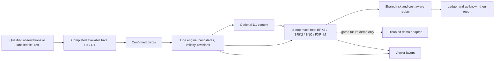

# Tori trendline strategy: complete build roadmap

Prepared 15 November 2026 (Africa/Johannesburg), revision 2. Companion to `TORI-TRENDLINE-STRATEGY-SPEC.md`, which defines the strategy (`TRL_V1`), a deterministic trendline strategy *inspired by* Tori Trades. This file says **how to build, test and evaluate it** inside your forex lab. Revision 2 incorporates an external review you supplied (Appendix C).

**Read this first.**
- Nothing here shows the strategy makes money. The only profit claim comes from its author and is unverified. This roadmap is the plan for finding out, honestly, whether a *mechanical interpretation* of the idea has an edge on your data.
- I have seen your lab only through its public README and the 144 plan. Where I describe your existing modules I am assuming, and I mark those places **(assumed)**. Check them against your actual tree before starting Phase 2.
- I am not a financial advisor.

---

## 0. At a glance

| | |
| --- | --- |
| **Goal** | A causal, deterministic, cost-aware research system for the Tori trendline strategy: line engine, four setups, two exit models, replay viewer, tests, and a pre-registered historical study |
| **Not the goal** | Live trading, optimisation, or proving that the original discretionary method works |
| **Reuse** | Most of the lab (bars, pivots, availability, ledger, risk, replay, reporting, protocol) |
| **New** | The trendline engine, the break and bounce setup machines, S/R levels for targets, and a line-aware viewer layer |
| **First hard gate** | Phase 10: count how many valid setups the engine finds on admissible data **before looking at any outcome** |
| **Data levels** | Level Q (quote based) and Level B (bar-based approximation). Every output is labelled; Level B makes no execution-precision claim |
| **Experiments** | A independent simulations (default), B paired exit comparison, C combined portfolio (later) |
| **Biggest risk** | Data. Your protocol needs qualified multi-year bid/ask data and none is currently assigned |
| **Elliott work** | Paused. Frozen as it stands, not edited |

### Phase map

```
0 Decisions        1 Rulebook & golden examples     2 Data & bars
3 Pivots           4 Trendline engine (core)        5 Top-down context
6 Setups           7 Execution, risk, costs         8 Replay viewer
9 Verification     10 Signal-count gate             11 Historical study
12 Shadow & demo readiness                          13 Optional tracks
```

Phases 1 to 9 are software. Phase 10 is the first contact with data. Phases 11 and 12 depend on admissible data and on the gates passing. **Software complete** and **market validated** are different claims and must stay different in every report.

---

## 1. Guiding principles

1. **Causality first.** Nothing known only later may influence an earlier decision. A line that "would have worked" because it was drawn with hindsight is the commonest way trendline backtests lie.
2. **Freeze before you look.** Every parameter, variant and trial is declared before any result exists. A change after results is a new version with a new trial, and it cannot reuse a holdout as untouched.
3. **Deterministic selection, abstention on conflict.** Where several lines or setups fit, a frozen ranking picks; unresolved ties and opposing signals abstain. Parser order never chooses a trade.
4. **Small steps, each with a pass condition.** Do not build the viewer, the demo adapter or the study before the line engine passes its tests.
5. **Count before you measure.** Signal counts come before returns (Phase 10). If there are too few setups, you learn that cheaply.
6. **Reuse, do not rewrite.** Prove parity with existing accounting rather than editing frozen code.
7. **Report abstentions.** Every skipped setup has a reason code. You must be able to explain a trade and a non-trade from the recorded inputs.
8. **Honest labels.** Invented fixtures are labelled invented. Hypothetical costs are labelled hypothetical. Approximate data are labelled approximate.

---

## 2. Pausing the Elliott work cleanly

Pausing means the Elliott project stays recoverable and untouched, and the trendline project cannot damage it.

### Tasks

- [ ] Add a short status note (for example `docs/ELLIOTT-EXPANSION-144-PAUSED.md`) stating: paused on 15 November 2026, why, last completed stage (take it from your 144 results file), what is outstanding, and the one thing needed to resume (the stage and decisions list).
- [ ] Commit and push the 144 plan and 144 results so they exist in the repository (the plan was only in your local folder when I looked).
- [ ] Do **not** edit `docs/ELLIOTT-*` protocol and result files. They are frozen records.
- [ ] Do not change frozen 117 to 126 inputs, manifests or results.
- [ ] Create the new work in a **separate package** (section 4), not inside `elliott_full/`.
- [ ] If a shared utility is needed by both (pivots, bars), do not edit it in place. Either import it through its current public interface, or copy it into the new package and add a parity test that proves identical output on the same fixtures. Refactoring into a shared package happens only after both projects are stable.
- [ ] Record in the decision log (section 11) that this project's reserved-data boundaries are inherited from the lab's existing declarations.

### What stays valid

The data boundaries you already declared (2024 seen, 2025 consumed, October 2026 quarantined, November to December 2026 reserved and untouched) apply to this project too. **Do not look at the reserved period while building.**

---

## 3. Where the two projects overlap: reuse map

| Lab component | Used by Elliott 144 | Needed for trendlines? | Decision |
| --- | --- | --- | --- |
| Input contracts, lineage, availability bounds | Yes | Yes | Reuse as is |
| Completed-bar aggregation, session calendar | Yes (D1/H4/H1) | Yes (H4, D1; later W1/MN) | Reuse, extend to W1/MN if context variants are used |
| Causal pivots (strict extrema, delayed confirmation, radius) | Yes (2, 4, 8) | Yes (radius 3 on H4) | Reuse the algorithm, new radius |
| Alternating swing view, supersede rules | Yes | Not needed for lines; useful for diagnostics | Optional |
| Bounded search with `search_incomplete` | Yes | Yes (pivot pair enumeration) | Reuse pattern |
| Ranking by frozen lexicographic tuple, abstain on tie | Yes | Yes (line ranking) | Reuse pattern |
| Setup identity and consumed-state groups | Yes (consumed at the first eligible quote) | Yes (line groups) | Reuse pattern, new key, and **consumption moves to the trigger** (spec A-21) |
| Expiry, formation and trigger separation | Yes | Yes | Reuse pattern |
| Structural stop with buffer, ATR14 | Yes | Yes | Reuse |
| Risk: fixed fraction, floor lots, one reservation, daily pause | Yes | Yes | Reuse unchanged |
| Offline quote-to-ledger adapter, costs, financing, gap handling | Yes | Yes | Reuse unchanged for Level Q; add a bar-based adapter for Level B |
| Checkpoints and deterministic restart | Yes | Yes | Reuse |
| Replay viewer with time cursor | Planned | Yes | Share the viewer, add line layers |
| Pattern grammar and count parser | Yes | **No** | Not used |
| Channel guideline (parallel lines) | Used as a ranking guideline | Geometry shared | Reuse line-fitting utilities only |
| Disabled demo adapter and native guards | Planned | Later (Phase 12) | Reuse design |

**Rule of thumb:** about two thirds of the infrastructure carries over. The trendline engine, the setup machines and the S/R target finder are new.

---

## 4. Architecture

### 4.1 Proposed layout **(assumed; adapt to your tree)**

```
src/forex_demo_lab/trendline/
  config.py        # loads and validates the declarative config (YAML)
  bars.py          # H4 / D1 (and later W1, MN) completed-bar views over admitted data
  pivots.py        # causal pivots with confirmation time (adapted from the lab)
  geometry.py      # line value, slope, normalised angle, distance, projections (exact arithmetic)
  lines.py         # candidate enumeration, validity, touches, pokes, revisions, lifecycle
  levels.py        # horizontal S/R levels from pivot clusters (E2 targets)
  context.py       # D1 (later W1/MN) gate
  setups.py        # BRK3, BRK2, BNC, FXR_M state machines
  exits.py         # E1 (trail and close-beyond) and E2 (target)
  sizing.py        # reuse or thin wrapper over the lab's risk module
  execution.py     # quote-to-ledger adapter (reuse)
  replay.py        # prefix checkpoints, deterministic replay
  report.py        # reports, JSON and CSV ledgers, reason codes
  viewer/          # HTML replay with time cursor and line layers
tests/trendline/
  fixtures/        # golden examples (hand-annotated), invented and labelled
tools/
  signal_count.py  # Phase 10 feasibility counter (no P&L)
docs/trendline/
  PROTOCOL.md      # frozen protocol declaration (one file)
  RESULTS-*.md     # per-phase evidence
```

Keep one protocol declaration and one config, as in your 144 plan, rather than a document per helper.

### 4.2 Data flow



### 4.3 Core data structures (sketch)

```python
@dataclass(frozen=True)
class Pivot:
    id: str; kind: Literal["high","low"]
    bar_index: int; price: Decimal
    occurred_at: datetime; confirmed_at: datetime   # confirmed_at > occurred_at

@dataclass(frozen=True)
class Line:
    id: str                       # canonical: symbol|tf|kind|A.id|B.id
    kind: Literal["support","resistance"]
    a: Pivot; b: Pivot
    touches: tuple[str, ...]      # pivot ids, in order
    age_bars: int                 # first touch to signal bar
    formation_span_bars: int      # first touch to last touch
    status: Literal["candidate","valid","poked","triggered","retired"]
    revision: int; formed_at: datetime
    metrics: LineMetrics          # slope/ATR, normalised angle, poke uses

@dataclass(frozen=True)
class Setup:
    id: str; strategy: str; group_id: str   # opportunity group (one attempt)
    action_line: Line; safety_line: Line | None
    state: Literal["forming","triggered","ready","skipped","abstained","expired","invalidated","awaiting_safety"]  # awaiting_safety only in the DLY variant
    reason_codes: tuple[str, ...]

@dataclass(frozen=True)
class Decision:           # explains a trade or a non-trade
    at: datetime; strategy: str; outcome: Literal["enter","abstain","skip"]
    reason_codes: tuple[str, ...]; inputs_hash: str
```

All price arithmetic uses decimal or rational numbers and the instrument's reported precision. No binary-float epsilons. Neither rounding nor tolerance may turn an observed violation into a valid line.

### 4.4 Determinism and versioning

- One strategy version string (`TRL_V1`) bound to the config hash and code hash in every output.
- Checkpoints bind input prefix, config and code version, all live lines, consumed setups, pending actions, held protection, cash, financing and loss latches. A corrupt or cross-version checkpoint is rejected.
- Restarted replay must match an uninterrupted replay exactly.
- Persisted revisions are immutable. Corrections create new revisions.

### 4.5 Config

Use the YAML starting point in the spec (Appendix B) as the single declarative config. Parameters are `P-xx` from the spec's table and appear in the file under the same names.

---

## 5. Phases

Size key: **S** a day or two of focused work, **M** about a week, **L** a few weeks, **XL** open-ended (depends on data). These are relative sizes, not promises.

---

### Phase 0. Decisions and scope freeze (size S)

**Goal:** settle every choice that would otherwise change the code later.

**Decisions to make (recommended default in bold):**

| # | Decision | Options | Recommendation |
| --- | --- | --- | --- |
| D1 | Instruments | EURUSD only; a small declared basket; plus metals | **EURUSD first**, then decide from Phase 10 counts whether more are needed |
| D2 | Setup timeframe | H4 | **H4** (both playbooks) |
| D3 | Context | None; D1 decision table (spec 7.6); weekly and monthly layers | **Baseline off; D1 table as a separate strategy.** W1 and MN later |
| D4 | Strategy set | The five IDs in spec 7.12 | **All five**, built in this order: `TRL_BRK3_E1`, `TRL_FXR_M`, `TRL_BRK2_E1` (**exactly 2 touches**), `TRL_BNC_E1`, `TRL_BRK3_E1_D1`. `DLY` is declared but not run |
| D5 | Line validity policy | Strict (any penetration poisons the line, no touch exception); tolerant (declared allowance) | **Strict.** Tolerant is a later declared variant. A later pivot confirmation never restores eligibility |
| D6 | Stop model | Current line plus buffer (core); projected 4 bars (FXR) | **Core: current line plus buffer. Projection only inside the `FXR_M` package** |
| D7 | Risk per trade | 0.25 percent (lab); 1 to 2 percent (video) | **0.25 percent.** Note it is not a pure scale factor: lot floors, margin and the daily pause change which trades occur |
| D8 | Pyramiding | Off; on | **Off** |
| D9 | Data level and source | Level Q (quote based); Level B (bar-based approximation); wait | **Your decision.** See Phase 2. Every output carries its level label |
| D10 | Cost profiles | Lab base and adverse | **Reuse** |
| D11 | Partitions | As declared in the lab | **Reuse. Keep the reserved period untouched** |
| D12 | Experiment types | A independent simulations; B paired exit comparison; C combined portfolio | **A by default, B for exit hypotheses, C only later** |
| D13 | When the one attempt is consumed | At the trigger; at the first eligible quote | **At the trigger**, so a skipped setup cannot be retried on the same line |
| D14 | Trial budget | See section 8 | **Fixed list, no grid, every attempted variant counted** |
| D15 | Signal-count gate | Minimum signals per strategy before outcomes are examined | **At least 60 signals per strategy over the development partition, else `INSUFFICIENT`** `[CONV]`. Narrow strategies (`BRK2`, `BNC`, the D1 gate) may fail this, which is itself a result |
| D16 | The `DLY` (delayed-safety) variant | Never; later | **Decide after Phase 10**, from the share of breaks that end in `NO_SAFETY_LINE` |

**Deliverables**
- [ ] `docs/trendline/PROTOCOL.md` listing the decisions above, the strategy set and the frozen parameter table (spec 7.2).
- [ ] Decision log started (section 11).

**Acceptance:** every `[AMBIG]` row in the spec has a recorded resolution you agree with, or an explicit change request.

**Risks:** deciding later under pressure to improve results. Counter: the protocol is committed before any outcome is computed.

---

### Phase 1. Rulebook and golden examples (size M)

**Goal:** turn the spec into machine-readable rules plus a small library of hand-checked examples that define "correct".

**Tasks**
- [ ] Convert spec sections 6 and 7 into a rulebook file (`rules.yaml` or similar): rule id, setup family, source tag (`V`, `TZ`, `FXR`, `CONV`, `CONV*`), status, positive and negative example ids.
- [ ] Hand-build **golden fixtures**: short invented H4 series (clearly labelled invented) that make each rule fire or not fire. Cover both directions (long and short) for every item:
  - [ ] a valid 3-touch resistance line and a clean close-break
  - [ ] **a wick that penetrates the line and closes back (the line must be `POKED`; no touch exception)**, and the spec example 9.3 with its replacement line
  - [ ] a contact that comes within tolerance **without penetrating** (counts as a touch once its pivot is confirmed)
  - [ ] a pivot confirmed after a penetration (must **not** restore the line)
  - [ ] touches closer than 6 bars (earliest accepted, later one skipped)
  - [ ] **exactly 2 touches (`BRK2`) versus 3 or more (`BRK3`), to prove the groups never overlap**
  - [ ] age of 29, 30 bars and formation span of 89, 90 bars (boundary cases)
  - [ ] a slope just under and just over each limit
  - [ ] a break with **no safety line at the close (baseline abstains, `NO_SAFETY_LINE`)**, and the same series run through `DLY` (spec 9.4), including the chase-invalidation and failed-break cases
  - [ ] a break where the stop is too far, too close, and **already crossed at entry**
  - [ ] a bounce contact that is not a pivot, a bounce contact followed by a close through the line, and a bounce too close to the last contact
  - [ ] a missed break (price already beyond the line when the line first becomes valid)
  - [ ] two opposing breaks on the same bar (both abstain, both consumed) and two same-side lines broken on one bar (ranking chooses one) (spec 9.5)
  - [ ] **a gap through the stop** (spec 9.6) with the expected slippage, loss and exceedance report
  - [ ] a long and a short example with hand-computed numbers (spec 9.1 and 9.2)
  - [ ] each cell of the D1 decision table (8 outcomes) plus unfinished D1 data
  - [ ] the S/R clustering procedure on a small set of pivots, including a duplicate H4 and D1 observation
- [ ] Also hand-annotate **real** examples later from admissible data (Phase 10), clearly separated as development evidence.
- [ ] Write the expected outputs (lines found, touches, pokes, setup states, stops, reason codes) next to each fixture by hand, before the code exists.

**Deliverables:** `rules.yaml`, `tests/trendline/fixtures/*`, expected-output files.

**Acceptance:** a second reader (you, a day later) can read each fixture and agree with its expected output without looking at code.

**Risks:** fixtures written to match whatever the code does. Counter: write expectations first.

---

### Phase 2. Data and bars (size L, depends on data)

**Goal:** produce completed, qualified, availability-aware H4 and D1 bars, and decide what data standard to use.

**This is where the project can stall**, as it did for the Elliott plan: the lab's own status says no assigned dataset satisfies the full study.

**The data decision (D9)**

| Option | What it means | Cost | Honest label |
| --- | --- | --- | --- |
| **Level Q**: qualified quote history | Years of timestamped bid/ask quotes with ordering and clock evidence, as the protocol requires | May not be obtainable; no source is currently assigned | `LEVEL_Q` |
| **Level B**: bar-based approximation | Historical H1 bars (bid OHLC plus a spread field, or source-supplied mid candles), aggregated to H4 and D1 | Fast, long history. Quote age, the first executable quote and intrabar order are unknown | `LEVEL_B`: strategy-behaviour research only. It cannot satisfy the broker-performance or demo gate and makes no execution-precision claim |
| Wait and collect | Prospective collection only | Years | n/a |

My recommendation: **start with Level B for development and signal counting** so the engine can be built and examined, labelled `LEVEL_B` everywhere. Treat Level Q as the route to any claim you would act on. This needs your explicit decision because it adds an approximation tier your protocol does not currently have.

**Geometry basis (a manifest field).** Lines are computed on one of: `mid_sync` (midpoints of synchronised quotes), `mid_candles_source` (candles supplied by the source as mid) or `bid_only`. **Never construct a midpoint by averaging bid-candle and ask-candle highs and lows**: that is not the high of synchronised midpoints. A source such as OANDA supplies separate mid, bid and ask candles; use the mid candles or the bid candles, not a blend.

**Tasks**
- [ ] Write the data manifest: source, hashes, date range, timezone and DST evidence, calendar and bar boundaries, coverage policy, quote or bar semantics, geometry basis, spread field meaning, commission and swap terms known or unknown, and the data level.
- [ ] Declare H4 bar boundaries from a calendar (not from a broker server label) and test DST transitions, weekend gaps and holidays.
- [ ] Aggregate H1 to H4 and D1 using only completed, qualified bars. Missing children block publication of the parent bar. No forward-filling of missing sessions, no guessed offsets, no removal of bad periods after seeing P&L.
- [ ] Build the availability model: each bar has an `available_at`. Unknown clock offsets stay unknown.
- [ ] Implement the Level B execution model (spec 7.1): entry at the open of the first H1 bar after the trigger H4 close; exits against H1 bid highs and lows with the spread field; same-bar stop and target always adverse.
- [ ] Reserve the held-out periods in code so that loading them requires an explicit, logged unlock.
- [ ] Write the coverage report: eligible, unknown, missing.

**Deliverables:** data manifest, bar builder, coverage report, level and basis labels on every output.

**Acceptance:**
- [ ] Aggregation tests pass: unfinished or delayed D1 and H4 data cannot influence earlier decisions; a missing child bar blocks the parent; DST and session boundaries are explicit.
- [ ] The held-out period cannot be loaded accidentally.
- [ ] A Level B run cannot be reported without its label, and cannot be fed into a demo-readiness gate.

**Risks:** data that looks fine but has shifted clocks or gaps; mixing Level B and Level Q results. Counter: separate labels and separate result files.

---

### Phase 3. Pivots (size S)

**Goal:** causal swing pivots on H4 (and D1 for the context variant).

**Tasks**
- [ ] Implement or import the strict centred extremum with radius `r = 3`. Equal extrema do not confirm.
- [ ] Store occurrence time and confirmation time separately. A pivot at bar `i` is available at bar `i + r` completion.
- [ ] A bar that qualifies as both a high and a low pivot is unresolved and excluded. Never choose the direction that gives the better line.
- [ ] Keep the pivot journal immutable. A later, more extreme pivot of the same kind can supersede in the alternating view but does not rewrite earlier history.
- [ ] Parity test against the lab's existing pivot output on the same fixtures if you reuse it.

**Tests:** appended future bars never change earlier pivots or their availability; equal highs do not confirm; a pivot is never usable before its confirmation bar completes.

**Acceptance:** all pivot tests pass; a pivot cannot backdate an entry to its occurrence bar.

---

### Phase 4. Trendline engine (size L; the core)

**Goal:** deterministic line enumeration, validation, ranking and lifecycle (spec 7.3 to 7.5).

**Tasks**
- [ ] `geometry.py`: line value at a bar, slope per bar, projection `n` bars ahead, ATR-slope and normalised-angle tests, using exact arithmetic. Implement `ATR_SMA14` (the simple mean of 14 true ranges, **not** TradingView's RMA-smoothed default) and test it against a hand-computed series, noting the difference from chart indicators.
- [ ] Pair enumeration over pivots inside `LINE_LOOKBACK_BARS` (600 H4 bars), capped at 256 per kind, with slope-sign and spacing constraints.
- [ ] **Touch detection (strict):** process pivots chronologically from A; accept only pivots on the correct side of the line (or exactly on it), within `0.25 x ATR_SMA14` measured **at the pivot's confirmation bar**, at least 6 bars after the previously accepted touch (earliest wins).
- [ ] **Poke detection (strict):** any completed bar strictly before the evaluated bar whose extreme penetrates the line by more than 0 ticks. **No exception for contacts that later become pivots.** A later confirmation never restores eligibility.
- [ ] Validity per strategy profile: touch requirement (exactly 2, 3 or more, 2 or more prior), **age** (first touch to signal bar) or **formation span** (first to last touch), slope tests.
- [ ] **De-duplication by touch set:** keep the line through the earliest and latest touch; ties go to the smallest sum of absolute touch distances, then the smallest canonical id; strict subsets are dropped.
- [ ] Frozen lexicographic ranking (touches, age, last-touch recency, earlier first-touch id), with canonical ids breaking only display ties.
- [ ] Lifecycle (`candidate`, `valid`, `poked`, `triggered`, `retired`) with immutable revisions; opportunity groups (`open`, `consumed`).
- [ ] Bounds: record `search_incomplete` and block new entries for that snapshot when the cap is exceeded. Never present a truncated search as exhaustive. Because the window is bounded, the cap cannot block entries forever.
- [ ] Re-derivation at each new pivot confirmation and a poke check on every completed bar: new revision, new id on replacement, consumed state preserved through group merges.

**Property tests (generated paths):**
- [ ] A line marked valid has no penetrating bar between its first touch and the evaluated bar.
- [ ] Adding future bars never changes lines published earlier; a late pivot confirmation never restores a poked line.
- [ ] Ranking is a total order (no non-transitive comparisons).
- [ ] Mirror symmetry: flipping prices (support to resistance) flips results exactly.
- [ ] Idempotence: replaying the same prefix twice gives identical revisions.
- [ ] De-duplication is order independent.

**Deliverables:** line engine, fixtures passing, a debug dump per bar (lines considered, why each was rejected).

**Acceptance:** every golden line fixture from Phase 1 passes; property tests pass; the debug dump explains each rejected candidate with a reason code.

**Risks:**
- Strict validity may kill most candidate lines, leaving very few. Counter: replacement lines from new pivots are part of the design; Phase 10 counts it; do not loosen the policy to produce lines (a tolerant policy is a separate declared variant).
- Too many valid lines (noise). Counter: the touch, spacing and age requirements; report line counts per bar as a diagnostic.

---

### Phase 5. Top-down context (size M)

**Goal:** the optional D1 gate (decision table, spec 7.6), plus the foundation for later W1 and MN layers.

**Tasks**
- [ ] Run the same line engine on D1 bars with `AGE_MIN_BARS` scaled to 15 D1 bars.
- [ ] Compute `S_below`, `R_above` (nearest valid, unpoked lines within 3 x ATR_SMA14(D1)) and `D1_bias` (`BULLISH`, `BEARISH`, `NEUTRAL`, `UNAVAILABLE`).
- [ ] Implement the 8-outcome decision table keyed on `trade_direction` (the direction of the trade, not of the broken line) and `D1_bias`, with reason codes `CONTEXT_CONFLICT`, `CONTEXT_NEUTRAL`, `CONTEXT_UNAVAILABLE`.
- [ ] Resolve context top-down without self-reference: D1 uses only its own evidence; H4 setups read the already-available D1 result. An unfinished D1 bar never influences an H4 decision.
- [ ] Declare W1 and MN as later extensions in the protocol, not enabled.

**Tests:** each of the 8 table cells; incomplete D1 data gives `UNAVAILABLE`; an unfinished D1 bar is invisible to H4; two implementations written from the table alone must agree.

**Acceptance:** table tests pass; the baseline strategies run identically with the gate off.

---

### Phase 6. Setup machines (size L)

**Goal:** `BRK3`, `BRK2` (exactly 2), `BNC`, `FXR_M` as explicit state machines with reason codes, and the `DLY` variant specified but disabled.

**State machine (breaks, baseline):**

```
FORMING --(close beyond action line by >= 1 tick, previous close on the other side,
           not the formation bar)--> TRIGGERED            [opportunity group CONSUMED here]
TRIGGERED --(valid safety line exists at the trigger close)--> READY
TRIGGERED --(none)--> ABSTAINED (NO_SAFETY_LINE)
READY --(stop outside 0.5 to 2.5 ATR, spread too wide, stop already crossed,
         context blocks)--> SKIPPED (reason)
READY --(first eligible quote, or next H1 open at Level B)--> ENTRY_ATTEMPT --> FILLED | NO_FILL
READY --(eligibility window ends)--> EXPIRED
FORMING --(a bar penetrates the line)--> INVALIDATED (POKED)
line first valid with price already beyond it --> DISCARDED (MISSED_BREAK)
```

**State machine (`DLY` variant, disabled):**

```
TRIGGERED (no safety line) --> AWAITING_SAFETY (at most 10 H4 bars)
AWAITING_SAFETY --(a bar closes back across the action line)--> INVALIDATED (FAILED_BREAK)
AWAITING_SAFETY --(a bar closes > 1.0 ATR beyond the trigger close)--> INVALIDATED (CHASE_LIMIT)
AWAITING_SAFETY --(valid safety line first exists at a bar's close)--> DECISION_BAR
DECISION_BAR --> READY, with the stop taken from the line at the decision bar (not the break)
AWAITING_SAFETY --(10 bars)--> EXPIRED
```

**Tasks**
- [ ] Break detection with previous-close-on-other-side check and formation/trigger separation; group consumed at the trigger.
- [ ] Safety-line selection (nearest valid opposing line, then touches) at the trigger close.
- [ ] Stop construction: **core = safety-line value at the trigger bar, buffered, rounded outward**; `FXR_M` = value projected 4 bars ahead, buffered. Stop window and spread filters. **`STOP_ALREADY_CROSSED` check against the executable exit-side quote at entry.**
- [ ] Opportunity groups: canonical key from symbol, direction, setup type and source line anchors; merges preserve consumed state.
- [ ] Simultaneous setups: collect all eligible groups before reserving; opposing sides abstain; same side uses the frozen ranking without the display tie-break; an unresolved tie abstains. All triggered groups are consumed.
- [ ] Bounce setup: **bounce contact** (not a confirmed touch) with correct-side, no-penetration, close-on-correct-side and spacing conditions; entry never waits for pivot confirmation.
- [ ] `FXR_M` profile (3 touches, spacing 6, formation span 90, both slope tests, entry after the break close, projected stop, `E2`).
- [ ] `DLY` implementation behind a disabled flag, with its own fixtures; not part of the initial trials.
- [ ] Reason codes for every non-entry (for example `NO_VALID_LINE`, `POKED`, `TOO_FEW_TOUCHES`, `AGE_TOO_SHORT`, `SPAN_TOO_SHORT`, `SLOPE_TOO_STEEP`, `NO_SAFETY_LINE`, `STOP_TOO_WIDE`, `STOP_TOO_TIGHT`, `STOP_ALREADY_CROSSED`, `SPREAD_TOO_WIDE`, `ALREADY_CONSUMED`, `MISSED_BREAK`, `OPPOSING_SIGNAL`, `CONTEXT_CONFLICT`, `CONTEXT_NEUTRAL`, `CONTEXT_UNAVAILABLE`, `BELOW_MIN_LOT`, `SEARCH_INCOMPLETE`, `DATA_GAP`, `FAILED_BREAK`, `CHASE_LIMIT`).

**Tests:** formation and trigger on the same bar is rejected; consumption at the trigger even when the setup is then skipped; a second signal on a consumed group is refused after restart; invalidation before an ambiguous breakout takes precedence; restarts at every state preserve consumed attempts.

**Acceptance:** all setup fixtures pass; replay-before-and-after-each-state tests match uninterrupted runs.

---

### Phase 7. Execution, risk and costs (size M)

**Goal:** turn setups into cost-aware simulated trades, with the lab's accounting.

**Tasks**
- [ ] Wire the setup output into the lab's offline quote-to-ledger adapter (Level Q) and the new bar-based adapter (Level B). Use the ask to buy and the bid to sell; long exits and stop checks use the bid, short use the ask. Long stop triggers at bid at or below the stop; short stop at ask at or above it.
- [ ] Sizing: `0.0025 x positive executable equity`, divided by per-lot loss to the stop including entry and exit costs; constrain by free margin, lot limits and headroom above the daily pause floor; floor to the lot step; skip below the minimum lot (`BELOW_MIN_LOT`); never round up.
- [ ] **One reservation per account.** Each independent strategy run (experiment A) is its own account. A combined portfolio (experiment C) and the demo adapter share one reservation, so only one strategy is enabled at a time in a demo. A position held at quote arrival prevents re-entry on that quote even if it exits there.
- [ ] Exits:
  - `E1`: hard stop; close-beyond-safety-line exit on the next executable quote; the stop tightens along the line value (never loosens); the safety line is frozen to the entry id and replaced only by a later line that gives a more protective stop. A poked safety line still defines the close-beyond exit until replaced.
  - `E2`: hard stop and an S/R target at least 2R away; no trailing (a convention).
  - A stop cannot execute before the position exists. After entry, if a bar could have touched both stop and target and the order cannot be resolved, take the adverse bound or report `UNAVAILABLE`; never assume a win.
  - Gaps: stops fill at the first observed breached executable quote with adverse slippage. Targets receive no favourable overshoot and need observed executable reach.
- [ ] S/R level finder (`levels.py`) as in spec 7.7.6: merge duplicate H4 and D1 observations, cluster by single linkage from the lowest price within the tolerance, representative price is the median, at least 2 observations, nearest level at least 2R away, none means skip.
- [ ] Costs: recorded bid/ask spread (or the bar spread field at Level B), hypothetical commission, slippage and financing profiles (base and adverse), the adverse spread floor, and the triple-swap rollover. Count embedded spread and slippage once.
- [ ] Daily loss pause at 99 percent of the day reference (UTC-day boundary), including floating losses and costs, with no same-day recovery reset and no reset without a valid reference and position reconciliation.
- [ ] Held-position protection continues even when new-entry gates (spread, warmup, context, pause) block entries.
- [ ] **Boundary handling:** at the end of a partition, close open positions at the first eligible executable quote inside the partition; if there is none, report `OPEN_AT_BOUNDARY`, exclude it from closed-trade statistics, list it separately, and mark equity at the last executable bid or ask with the gap disclosed.
- [ ] Report every case where realised loss exceeds the estimated entry loss (gaps, slippage, financing).

**Parity tests:** reproduce retained accounting cases from the lab's existing ledger (the 120 and 125 cases) on the new adapter before using it for any trendline trade.

**Acceptance:** an independent rational-arithmetic reconstruction of cash, costs, fills, financing and equity matches the ledger for constructed paths.

**Risks:** a tiny account cannot trade at 0.25 percent risk (the minimum lot exceeds the budget). Report that; do not raise risk to force trades. Results at different risk fractions are not rescaled copies of each other.

---

### Phase 8. Replay and viewer (size M)

**Goal:** make every trade and every non-trade inspectable, which is essential for a strategy as visual as this one.

**Tasks**
- [x] Local HTML viewer with a time cursor. By default only what was known at the cursor is drawn.
- [x] Layers: H4 candles, confirmed pivots (provisional versus confirmed), valid lines with their revisions, poked lines (greyed, with the penetrating bar marked), the action line, the safety line, stop, target, fills, bounce contacts, and every no-trade reason.
- [x] A clearly labelled retrospective view for the completed chart that never rewrites the earlier view.
- [x] Export a readable report plus JSON and CSV ledgers, labelled with the data level and geometry basis.
- [x] Line and trade explanations: click a trade to see touches, age or span, slope metrics, safety line and the exact reason chain.
- [x] Side-by-side with a manual annotation: load your hand-drawn lines for the same chart to compare with what the engine found.

**Acceptance:** you can pick any trade, a loss and a skipped setup, and see the lines as they were known then, with exact timing.

Software acceptance passed on invented Level B and Level Q runs in sprint 191.
[Visual acceptance and annotation format](../trendline/RESULTS-191.md)

**Risks:** the viewer tempts you to fit parameters to what looks right. Counter: the protocol forbids parameter changes after viewing development outcomes; the viewer shows what the frozen rules did.

---

### Phase 9. Verification (size M)

**Goal:** prove the implementation behaves as specified before it touches market data.

**Test matrix**

| Area | Required evidence |
| --- | --- |
| Pivots | Strict extrema, equal highs, confirmation delay, dual-extreme bar excluded, causality under appended and mutated future data |
| `ATR_SMA14` | Hand-computed series; explicit test that it differs from an RMA-smoothed ATR |
| Touches and spacing | Spacing 5, 6, 7 boundary; chronological selection (earliest wins); correct-side only; tolerance boundary; tolerance measured at confirmation; A and B counted |
| Pokes | Any penetration poisons the line; no touch exception; late pivot confirmation never restores; break bar excluded from the poke check |
| Age and span | Age 29, 30; formation span 89, 90; first-to-signal versus first-to-last measured separately |
| Slope | Just under and over both tests; mirror for the short side |
| Ranking and dedupe | Total order; ties abstain; canonical id never selects a trade; deduplication by touch set is order independent |
| Lifecycle | Poked then replaced; retired; revision immutability; groups merge with consumed state |
| Bounds | 257th pivot and the lookback window; `search_incomplete` blocks entries for that snapshot only |
| Context | All 8 decision-table outcomes, `UNAVAILABLE` cases, unfinished D1 data |
| Breaks | Formation versus trigger bar, previous close on the other side, margin of one tick, missed break discarded, **consumption at the trigger** |
| Safety line | Missing (baseline abstains), `DLY` waiting, chase limit, failed break, expiry, wrong side of price |
| Stop and sizing | Core stop versus projected stop, buffer, outward rounding, window filter, **stop already crossed**, floor lots, minimum lot rejection, margin, headroom |
| Exits | Hard stop; close-beyond; tightening only; replacement line rules; gap overshoot; **stop cannot fire before entry**; adverse same-bar ambiguity |
| Costs | Spread, commission, slippage, triple swap, embedded costs counted once |
| Concurrency | One reservation per account; independent runs do not interfere; opposing signals abstain; same-side group ranking |
| Duplicates and restart | Replay before and after confirmation, trigger, reservation, fill, stop, pause; consumed attempts persist; conflicting duplicates rejected |
| Data levels | Level B entry at the next H1 open, bid-only geometry, label required, cannot feed a demo gate |
| Boundaries | Open position at partition end: closed, or `OPEN_AT_BOUNDARY` and excluded |
| Accounting | Independent rational reconstruction; differential checks against the lab's retained cases |
| Native adapter (disabled) | Actual DEMO enum required; REAL, CONTEST or unknown rejected; ambiguous acknowledgement; partial fills; restart reconciliation |

Use deliberately constructed paths and bounded generated sequences. These establish implementation behaviour, not a win rate. Run targeted checks per slice and the relevant integration suites before completion; do not repeatedly rerun unchanged broad suites without a reason.

**Acceptance:** every row has passing success and failure tests.

Sprints 192–193 complete software acceptance on invented inputs, including
fault tests for the compiled, disabled native contract.
[Verification matrix](../trendline/VERIFICATION.md) · [Native contract evidence](../trendline/RESULTS-193.md)

---

### Phase 10. Signal-count gate (size M; first contact with data)

**Goal:** find out how many setups exist **before looking at any outcome**.

This is the single most useful early step for a swing strategy. Setups on H4 may be rare, and your own screen needs at least 50 closed validation trades.

**Tasks**
- [x] Implement `tools/signal_count.py` for development-only replay. Software verification uses labelled invented Level B and Level Q inputs.
- [x] Count valid lines, breaks, `READY` setups, pre-account entry-eligible opportunities, skips by reason, abstentions and consumed groups by strategy, cost profile and month. Protocol C6 defines entry eligibility.
- [x] Report lines per bar, strict penetration, average line age, the `NO_SAFETY_LINE` share, stop distance in ATR, spread-to-stop ratio and the trigger touch counts.
- [x] Declare the D15 minimum of 60 entry-eligible opportunities per strategy across development. Apply the decision tree once the historical source is admitted.
- [ ] **Decide the `DLY` variant (D16)** from the `NO_SAFETY_LINE` share, before any outcome is computed.
- [ ] Look at 10 to 20 real engine-found examples in the viewer and compare to your own judgement. Anything you would change is a **proposal for a new version**, not an in-place edit.
- [ ] Publish the feasibility status: what data is eligible, what is unknown, the smallest evidence needed to proceed.

**Acceptance:** a written feasibility result with counts. If the gate fails, stop and decide, do not loosen rules to create signals.

Sprint 194 verifies the counter. Sprint 195 reviews historical sources and
prioritizes the Exness public archive for qualification. Sprint 196 confirms
ZIP headers for the exact 2020–2022 EURUSD annual archive links. Historical
counts remain `UNAVAILABLE` pending admission. Sprint 197 documents the 2022
platform clock and ordinary forex hours for the source review.
Sprint 198 checks opening and warmup timestamp coverage on invented input.
Sprint 203 checks the format and timing of one January 2022 public archive
sample. Sprint 204 corroborates the summer schedule with a July sample.
Sprint 205 verifies a conservative Level B opening model on invented tapes.
Sprint 206 reviews the saved MT5 export and an alternative H1 bid/ask catalogue.
Sprint 207 checks the latest public methodology and bounds possible first-open
timing using invented calendars.
Sprint 208 applies the timing check to a candidate 2022 Exness ordinary-hours
grid. The positive-delay result depends on shortened Friday H4 bars.
Sprint 209 finds zero timely decisions in that scenario if H4 publication
waits for a quote at or after the first H1 opening and takes two seconds.
Sprint 210 reviews retained receipts and tests a weekend publication audit on
invented traces. Ordered historical receipt evidence remains missing.
Sprint 211 verifies a clock-based publication model on invented source-time
quotes. The retained Sunday labels still miss the modeled exact opening.
Sprint 212 checks paired opening proxies and Friday H4 child quote presence
on the pinned January archive.
Sprint 213 maps the pinned July sample's exact source quotes to H4 entry
windows and verifies the deadline sensitivity.
Sprint 214 bounds the age of the last archived quote at each retained
Sunday opening and documents the gap to the first later quote.
Sprint 215 identifies the development count prerequisites in the preflight
and checks the proposed read scope against declared holdout dates.
Historical use still requires an admitted source and a reviewed price,
spread and timing declaration.
Sprint 216 adds a historical Level B H1 reader that verifies the reviewed
manifest and plan scope before opening prices. The historical calendar and
counter integrations remain open. [Reviewed historical input](../trendline/RESULTS-216.md)
Sprint 217 verifies an explicit historical calendar and causal H1, H4 and D1
coverage on fabricated inputs. [Historical session coverage](../trendline/RESULTS-217.md)
Sprint 218 runs the Level B counter through the reviewed input path and
excludes warmup triggers from the development totals.
[Historical development counter](../trendline/RESULTS-218.md)
Sprint 219 benchmarks the full historical Level B window on fabricated
prices and verifies count parity on the BRK3 comparison fixture.
[Full-window counter benchmark](../trendline/RESULTS-219.md)
Sprint 220 preserves the shortened Sunday opening in the historical
calendar and reproduces the 2022 timing scenario.
[Source review and calendar compatibility](../trendline/RESULTS-220.md)
Sprint 221 keeps completed bid geometry available when the first H1
opening lacks eligible evidence.
[Separate opening evidence](../trendline/RESULTS-221.md)
Sprint 222 narrows the strict 2022 Exness opening ceiling to 42 before
strategy and price filters on the ordinary-hours scenario.
[Strict-opening ceiling](../trendline/RESULTS-222.md)
Sprint 223 verifies that EV’s published 2024 H1 opens match the first
M5 opening bid and ask in each hour. The first underlying quote and
historical receipt remain unverified.
[Historical bar-open source review](../trendline/RESULTS-223.md)
Sprint 224 finds that all published EV 2024 H1 rows fit Dukascopy's
ordinary hours. Missing hourly slots cluster in Christmas and New Year
notice windows. Exact closures and M5 gaps still need evidence.
[EV calendar diagnostic](../trendline/RESULTS-224.md)
[Counter](../trendline/RESULTS-194.md) · [Archive inventory](../trendline/RESULTS-196.md) · [Coverage checks](../trendline/RESULTS-198.md) · [Summer timing](../trendline/RESULTS-204.md) · [Opening evidence](../trendline/RESULTS-205.md) · [Candle sources](../trendline/RESULTS-206.md) · [Timing audit](../trendline/RESULTS-207.md) · [Exness calendar timing](../trendline/RESULTS-208.md) · [Weekend publication timing](../trendline/RESULTS-209.md) · [Weekend receipt review](../trendline/RESULTS-210.md) · [Clock publication model](../trendline/RESULTS-211.md) · [Opening approximation](../trendline/RESULTS-212.md) · [H4 opening alignment](../trendline/RESULTS-213.md) · [Weekend quote bounds](../trendline/RESULTS-214.md) · [Development preflight](../trendline/RESULTS-215.md)

**Decision tree:**

```
counts >= gate on EURUSD  -> proceed to Phase 11 on EURUSD
counts <  gate            -> declare a second instrument set (before outcomes), recount
still <  gate             -> report INSUFFICIENT; do not run the study; consider lower scope
```

Adding instruments increases sample size, but correlated pairs (for example EURUSD and GBPUSD) are not independent; report correlation exposure and avoid presenting them as independent discoveries.

---

### Phase 11. Historical study (size XL, data-dependent)

**Goal:** a pre-registered, chronological evaluation with every cell accounted for.

Sprint 199 found that the 2021–2022 Phase 10 development candidate has no
later 24-month validation block in historical dates through 18 November 2026
under the frozen restrictions. [Validation date check](../trendline/RESULTS-199.md)

Sprint 200 verified public archive headers and date checks for an earlier
candidate with 2016–2017 development and 2018–2019 validation. Source,
coverage and prior exposure require review before assigning dates.
[Earlier archive inventory](../trendline/RESULTS-200.md)

Sprint 201 found dated platform-clock and quote-handling evidence for the
earlier candidate. Archive qualification and prior-trial completeness remain
open. [Historical source and exposure review](../trendline/RESULTS-201.md)

Sprint 202 records the user’s no-known-exposure statement for 2018–2019.
The earlier validation candidate still needs review of undated price displays
and the full prior-trial history. [Exposure and trial history](../trendline/RESULTS-202.md)

**Registration (before returns)**
- [ ] One source and run manifest freezing source hashes, permitted dates, **complete prior-trial history including every variant tried during development**, timezone and DST evidence, calendar and bar boundaries, coverage policy, data level and geometry basis, latency assumptions, cost, contract, margin and financing evidence, code and rule hashes, and exit endpoints.
- [ ] The strategy list, cost profiles, partitions and experiment types below, fixed.
- [ ] The exact development and test dates, the treatment of positions crossing partition boundaries (Phase 7), and a frozen uncertainty method.

**Experiment A: independent simulations (cells)**

| Strategies | Costs | Partitions | Cells |
| --- | --- | --- | --- |
| `TRL_BRK3_E1`, `TRL_FXR_M`, `TRL_BRK2_E1`, `TRL_BNC_E1`, `TRL_BRK3_E1_D1`, the lab's `T12_D` daily trend control, `CASH` | base and adverse | development and untouched validation | 7 x 2 x 2 = **28** |

Each strategy runs on its **own account**, so results do not reflect competition for capital. If you drop strategies, state the smaller number before running. These are correlated comparisons, not independent discoveries.

**Experiment B: paired exit comparison (declared analysis, not extra cells)**
- [ ] Take the entry events of `TRL_BRK3_E1` and apply `E1` and `E2` to **the same entries with the same initial stop and sizing**. Report separately the entries with no valid 2R target (where `E2` would skip). This is the clean test for H-04 and H-05; `TRL_FXR_M` cannot attribute differences to exits because its formation, stop and exit all differ.

**Experiment C: combined portfolio (later, only if wanted):** several strategies share one account and one reservation. Interpret as a portfolio result, not as a comparison of rules.

**Procedure**
- [ ] Freeze `TRL_V1` before development returns.
- [ ] Run development once, then untouched validation once with the same rules.
- [ ] Each cell starts with USD 10,000 and no incoming position. Prior prices may warm up a validation account, but development trades and profits do not carry across.
- [ ] Boundary exits need an actual eligible quote inside the partition. Missing endpoints are `OPEN_AT_BOUNDARY` and unavailable; no later quote closes a development trade.
- [ ] No automated optimisation, no post-result selection of setups.

**Report** the metrics in spec section 11, plus results by line kind, touch count, stop-distance bucket and regime (descriptive only), and the total number of strategies and variants tried.

**Screen** (from your protocol): positive net profit and net expectancy under both validation cost profiles, adverse observed drawdown at most 5 percent, at least 50 closed validation trades and 24 monthly marks. `INSUFFICIENT`, `FAIL` or `UNAVAILABLE` are valid, honest outcomes. A pass earns further research review only. For each hypothesis, classify the result as **supported, not supported or inconclusive**: too few trades is inconclusive, and an estimated absence of benefit is not proof that no benefit exists.

**If real fees cannot be established** but price and time qualify, one additional hypothetical-cost sensitivity batch is allowed under its own pre-return manifest and label. It cannot satisfy the demo gate or overwrite the qualified study. If its validation outcomes are inspected before the qualified study is frozen, those dates cannot serve as untouched validation later. Level B data support only this kind of labelled, behaviour-level study.

**Acceptance:** all declared cells accounted for, qualifications, results and limitations clear.

---

### Phase 12. Forward shadow and demo readiness (size L, gated)

**Goal:** operational evidence on live data without orders, then (only if gates pass) a bounded demo run.

**Tasks**
- [ ] After a qualified (Level Q) historical screen and review, freeze the shadow window, source, session calendar and unchanged rules **before** observing its prices.
- [ ] Proposed operational sample: 60 scheduled market sessions with at least 20 closed shadow trades and zero unexplained duplicates, position mismatches, future-data uses or missing risk actions. Because this strategy trades rarely, 20 closed trades may take much longer than 60 sessions; do not extend the window to obtain a pass. A further window is a new declared study.
- [ ] Build the demo adapter **disabled by default**, in a separate boundary with no broker submission import in the research package. Test it with fault injection before any run. Enable only one strategy at a time (one shared reservation).
- [ ] Guards: actual account type enum is DEMO immediately before every submission, modification and cancellation; account continuity in memory; connection and reconciliation checks; REAL, CONTEST or unknown blocks.
- [ ] Persist intent before submission; never retry an ambiguous acknowledgement blindly; reconcile owned pending orders, partial fills and positions; preserve a protective stop on partial fills; failed protection triggers a guarded emergency close and a latched halt.
- [ ] No credentials, identifiers or identity-derived hashes in code, logs, reports or version control.
- [ ] Deployment into an isolated owned directory, compile and inspect diagnostics before any demo trial.

**Not in scope:** real-money mode or a toggle, new broker accounts, login automation, permanent terminal or power-setting changes, paid services.

**Acceptance:** operational evidence and native build checks complete; no automatic activation. "Software complete" and "market validated" remain separate claims.

---

### Phase 13. Optional tracks (size varies; none required)

| Track | What | Why |
| --- | --- | --- |
| 13A Manual practice | Hand-trade the checklist (spec section 14) on demo charts for 30 to 50 setups and log them | Builds feel and golden examples. Treat results as illustrative only |
| 13B Second instrument | Declare metals or another pair in advance, with its own contract and data declaration | Tests hypothesis H-07, or helps the signal count |
| 13C Context extension | Add W1 and MN layers and the video's full chain of connected lines | Closer to the original method. Multiplies the declared trials, so only after the base results |
| 13D Binary experiment | Add strategy "D Trendline break" to your signal log (5- or 15-minute lines, fixed written rules, 3 or more touches, close-based break) | Tests the one idea that transfers. Judge it separately, using the 54.05 percent break-even maths |
| 13E Pyramiding variant | Allow adds, as one TradeZella example shows | A new declared strategy, off by default, conflicts with the lab's current rule |
| 13F Placebo control | Same stops and sizing, random entries matched to the break time window | Checks whether the line logic adds anything beyond a generic trend-following entry |
| 13G `DLY` variant | Run the delayed-safety variant if Phase 10 shows it is needed | A new declared trial with its own count |
| 13H Tolerant validity | A declared penetration allowance | A new declared trial; never a quiet change to the strict rule |

---

## 6. Test fixtures and golden-example workflow

1. **Invented fixtures** (Phase 1) define behaviour. They are labelled invented everywhere and never presented as market performance.
2. **Real examples** (Phase 10 onward) are screenshots or exports of engine output with your own annotation. They are *development evidence*, used to find bugs or ambiguities in the spec. They never become the untouched test.
3. For every bug found: write a failing test, fix, record in the decision log. If the fix changes economics, it is a spec change and a new version.
4. Keep a fixtures index with: id, rule(s) exercised, direction, expected outcome, who wrote it, date.

---

## 7. Data plan

| Need | Detail | Status |
| --- | --- | --- |
| H4 and D1 bars for EURUSD | At least 253 prior sessions of warm-up (for ATR and pivots, lab convention) plus 24 months development and 24 months untouched validation | Not assigned today (per your lab's status) |
| Quote semantics | Level Q: bid and ask quotes, midpoint of synchronised quotes for geometry | Level B gives bid OHLC (or source mid candles) plus a spread field, which is an approximation. Never blend bid and ask candle extremes into a midpoint |
| Calendar | Declared session and DST rules; Wednesday triple-swap day | To declare |
| Costs | Actual commission, swap, margin and contract terms from the broker; otherwise hypothetical, labelled | Unknown today |
| Second instrument (optional) | Same standards | Decide after Phase 10 |

Do not reopen closed provider routes or assign new capture dates through this project plan. Do not buy data or services without a separate decision.

---

## 8. Trial budget and anti-overfitting policy

Degrees of freedom that exist in this strategy, and how each is controlled:

| Degree of freedom | Control |
| --- | --- |
| Pivot radius, lookback window, pivot cap | Fixed at 3, 600 bars, 256 per kind |
| Touch tolerance, penetration allowance | Fixed, frozen (strict, allowance 0) |
| Touch counts, spacing, age, formation span | Fixed per strategy ID (`BRK2` exactly 2, so groups never overlap) |
| Slope limits | Fixed, two explicit approximate metrics |
| Break margin | Fixed |
| Stop model, buffer, ATR window | Fixed; core and FXR stops are separate strategy IDs |
| Exit model | Two models as separate strategy IDs, plus one paired comparison on identical entries |
| Context gate | One variant as a separate strategy ID, with a fixed decision table |
| Delayed-safety and tolerant-validity variants | Declared, not run unless added as new trials |
| Instruments | Declared list; additions declared before outcomes |
| Data level | Declared; Level B results labelled and kept separate |
| Partitions | Fixed by protocol |

**Rules**
- Fixed grammar and ranking. No parameter grid, no best-month selection, no hidden retries.
- **Count every alternative.** The trial total in each report includes every strategy, variant and parameter set tried during development, not only those that reach the final table. Research on backtest overfitting makes the point that results cannot be interpreted without this count.
- Maximum initial budget: the 28 qualified cells of experiment A, plus the one declared paired exit analysis (experiment B), plus at most one optional hypothetical-cost sensitivity batch of the same shape under its own manifest. Any further batch, variant or version is recorded before execution.
- A revision after results is a new trial and cannot reuse the holdout as if untouched.
- No statistical-significance or probability claim without a separately frozen inference method that accounts for the number of attempts and for dependence between overlapping, correlated results.

---

## 9. Risks and mitigations

| Risk | Impact | Mitigation |
| --- | --- | --- |
| No admissible data | Study cannot run | Phase 10 feasibility, labelled approximation tier, honest `UNAVAILABLE` |
| Too few setups | Cannot reach 50 closed trades | Signal-count gate; declare more instruments before outcomes |
| Hindsight leakage in line logic | Inflated results | Causality tests; immutable revisions; prefix replay |
| Subjective choices hidden in parameters | Overfitting | Frozen protocol; abstention; no grid |
| Public rules incomplete or misreported | Version differs from Tori's real method | Spec labels every `[CONV]`; study never claims to validate her method |
| Source commercial bias | Overestimated edge | Treat performance claims as unverified |
| Financing and gaps on multi-day holds | Real losses exceed estimates | Model rollover, gap fills, report exceedances |
| Scope creep (viewer polish, extra setups) | Delay | Phase gates; optional tracks stay optional |
| Switching back to Elliott mid-build | Two half-built systems | Pause note, separate package, parity tests |
| Over-engineering again | Months of infrastructure with no result | Phase 10 comes before the viewer polish and the demo adapter; the lab's own README shows the pattern to avoid |
| Mistaking software completion for market validation | Acting on untested claims | Separate claims in every final handoff |
| Strict validity leaves very few lines | Too few setups | Replacement lines; Phase 10 counts it; any relaxation is a separate declared variant, never a quiet change |
| Level B results read as execution evidence | Overstated precision | Level labels on every output; Level B cannot feed a demo gate |
| Selection risk from many strategies, variants and revisions | A lucky result mistaken for an edge | Count every attempted alternative; frozen inference method; inconclusive is a valid outcome |
| Shared capital confounding comparisons | Wrong attribution of differences | Independent accounts by default; paired exit comparison on identical entries |

---

## 10. Definition of done

**Software complete** when: phases 1 to 9 pass; a deterministic replay matches uninterrupted replay; every non-trade has a reason code; the viewer explains any trade and any skipped setup; reproducible commands exist.

**Feasibility complete** when: Phase 10 has produced counts and a written status.

**Study complete** when: Phase 11 has accounted for every declared cell with `PASS`, `FAIL`, `INSUFFICIENT` or `UNAVAILABLE` and stated limitations.

**Demo ready** only when: a qualified historical screen is passed, the shadow window meets its operational gate, native build checks pass, and a specific bounded demo run is explicitly enabled by you. This roadmap does not authorise it.

The final handoff states separately: implemented features, tested features, pattern and line limitations, data eligibility, measured strategy results (if any), and demo activation state. It names the next concrete blocker if a data-dependent stage is unavailable.

---

## 11. Decision log (template)

| Date | ID | Decision | Alternatives | Reason | Result seen before deciding? (must be No) |
| --- | --- | --- | --- | --- | --- |
| | D1 | | | | |

Also log every bug found in development, every spec change and every new trial.

---

## 12. First sprint: what to do on day one

1. Add the Elliott pause note and push the 144 files.
2. Create `docs/trendline/PROTOCOL.md` from this roadmap's Phase 0 table and the spec's parameter table.
3. Decide D9 (data level and source) and note it in the log.
4. Write 10 golden fixtures (Phase 1) with expected outputs **before** any code.
5. Implement pivots and geometry with tests (Phases 3 and the geometry half of 4).
6. Only then enumerate and validate lines.

Do not start the viewer, the demo adapter or any market-data study in the first sprint.

---

## 13. Status tracker

```
[ ] 0  Decisions frozen and protocol committed
[ ] 1  Rulebook and golden fixtures with hand-written expectations
[ ] 2  Data manifest, H4/D1 bars, coverage report, held-out periods locked
[ ] 3  Causal pivots with confirmation times
[ ] 4  Line engine: enumerate, validate, rank, lifecycle, revisions
[ ] 5  D1 context gate
[ ] 6  Setup machines with reason codes
[ ] 7  Execution, risk, costs, ledger parity
[ ] 8  Replay viewer and reports
[ ] 9  Verification matrix passing
[ ] 10 Signal-count gate and feasibility status
[ ] 11 Historical study (or explicit UNAVAILABLE / INSUFFICIENT)
[ ] 12 Shadow window and disabled demo adapter checks
[ ] 13 Optional tracks chosen (if any)
```

---

## Appendix A. Pseudocode for the core algorithms

### A.1 Line enumeration (resistance shown; support is the mirror)

```python
def enumerate_lines(pivots_high, bars, atr_at, params, now_idx):
    piv = [p for p in pivots_high if p.confirmed_at <= bars[now_idx].available_at
           and now_idx - p.bar_index <= params.lookback_bars][-params.pivot_cap:]
    lines = []
    for a, b in combinations(piv, 2):                       # a earlier than b
        if b.bar_index - a.bar_index < params.min_tap_spacing: continue
        slope = (b.price - a.price) / (b.bar_index - a.bar_index)
        if slope >= 0: continue                             # resistance lines must fall
        value = lambda k: a.price + slope * (k - a.bar_index)
        # strict poke check: bars strictly between a and now_idx (the evaluated bar is excluded).
        # NO exception for contacts that later become pivots; later confirmation never restores a line.
        if any(bars[k].high - value(k) > params.pen_allow
               for k in range(a.bar_index + 1, now_idx)):
            continue
        touches = accept_touches(piv, a, value, atr_at, params)  # chronological, earliest wins
        if not requirement_met(len(touches), params.strategy): continue
        if not age_or_span_ok(touches, now_idx, params): continue
        if not slope_tests_pass(slope, bars, atr_at(now_idx), params): continue
        lines.append(make_line(a, b, touches))
    lines = dedupe_by_touch_set(lines)                      # earliest+latest touch geometry, then smallest sum |dist|
    return sorted(lines, key=rank_key)                      # touches desc, age desc, last touch desc, first-touch id asc

def accept_touches(piv, a, value, atr_at, params):
    touches, last = [a], a
    for p in piv:                                           # chronological
        if p.bar_index <= a.bar_index: continue
        if p.bar_index - last.bar_index < params.min_tap_spacing: continue   # earliest wins
        dist = value(p.bar_index) - p.price                 # resistance: pivot high must be at or below the line
        if 0 <= dist <= params.touch_tol_atr * atr_at(p.confirmed_idx):     # correct side, within tolerance
            touches.append(p); last = p
    return touches
```

### A.2 Break detection and group consumption

```python
def on_bar_close(bar, lines, state):
    for line in lines.valid_resistance:                     # long breaks
        g = state.group_of(line)
        if g.consumed or line.formed_at >= bar.close_time: continue
        v, v_prev = line.value(bar.index), line.value(bar.index - 1)
        if bar.close >= v + params.break_margin and prev_close <= v_prev:
            if already_beyond_when_valid(line): discard("MISSED_BREAK"); continue
            g.consumed = True                               # one attempt per line group: consumed at the trigger
            create_setup(line, direction="long", trigger_bar=bar)
```

### A.3 Stop construction (core, with the checks)

```python
def initial_stop(direction, safety_line, trigger_bar, atr, tick, proj_bars):   # proj_bars = 0 core, 4 FXR_M
    level = safety_line.value(trigger_bar.index + proj_bars)
    buf = max(tick, params.stop_buffer_atr * atr)
    raw = level - buf if direction == "long" else level + buf
    return round_away_from_price(raw, tick, direction)

def entry_checks(direction, entry_quote, stop, atr, spread):
    exit_side = entry_quote.bid if direction == "long" else entry_quote.ask
    if (direction == "long" and exit_side <= stop) or (direction == "short" and exit_side >= stop):
        return "STOP_ALREADY_CROSSED"
    dist = abs(entry_price(entry_quote, direction) - stop)
    if not (params.min_stop_atr * atr <= dist <= params.max_stop_atr * atr): return "STOP_OUT_OF_WINDOW"
    if spread > params.max_spread_stop_frac * dist: return "SPREAD_TOO_WIDE"
    return "OK"
```

### A.4 `E1` management each completed bar

```python
def manage_E1(position, bar, state):
    line = position.safety_line                              # frozen to the entry id
    buf = max(tick, params.stop_buffer_atr * atr_sma14(bar))
    level = line.value(bar.index)                            # current line value (no projection)
    new_stop = level - buf if position.long else level + buf
    position.stop = tighten_only(position.stop, new_stop, position.direction)
    repl = state.replacement_for(line)                       # only a line formed after entry
    if repl and more_protective(repl, position): position.safety_line = repl
    if (position.long and bar.close < line.value(bar.index)) or \
       (position.short and bar.close > line.value(bar.index)):
        schedule_exit_on_next_executable_quote(position, reason="CLOSE_BEYOND_SAFETY")
```

### A.5 Sizing

```python
def lots(equity, entry, stop, costs, spec):
    budget = params.risk_fraction * max(equity, 0)
    per_lot_loss = abs(entry - stop) / spec.tick * spec.tick_value + costs.round_turn_per_lot
    raw = budget / per_lot_loss
    lots = floor_to_step(raw, spec.lot_step)
    return lots if lots >= spec.min_lot else 0               # never round up; reason BELOW_MIN_LOT
```

### A.6 `DLY` variant (disabled)

```python
def on_bar_close_dly(setup, bar, safety_candidates):
    if closed_back_across(setup.action_line, bar):  return invalidate(setup, "FAILED_BREAK")
    if chase_distance(bar, setup.trigger_close, setup.direction) > params.max_chase_atr * atr_sma14(bar):
        return invalidate(setup, "CHASE_LIMIT")
    if bar.index - setup.trigger_bar.index > params.expiry_bars: return expire(setup)
    line = best_valid_safety_line(safety_candidates)
    if line:                                                 # this bar is the decision bar
        setup.stop = initial_stop(setup.direction, line, bar, atr_sma14(bar), tick, proj_bars=0)
        setup.state = "READY"                                # then the usual entry checks apply
```

---

## Appendix B. How this answers "similar to Elliott"

You saw that both strategies are about swings, confirmation and structure. That is why this roadmap deliberately keeps the lab's backbone (causality, abstention, one attempt, structural stops, shared risk, replay) and replaces only the part that is different: instead of parsing wave grammar, the engine fits and validates **lines**. If you resume Elliott later, nothing here blocks it, and anything you improved in shared plumbing can be brought back through the parity tests.

## Appendix C. Revision log

**Revision 2 (15 November 2026): changes made after an external review you supplied.** The review's points were checked and I agreed with the substance of all of them. Where the review left a choice open, the decision is marked.

| Review point | What changed in this roadmap |
| --- | --- |
| Describe `TRL_V1` as an adaptation | Header and Phase 0 state it as a deterministic strategy inspired by Tori Trades; the spec has a departures table |
| Touch, poke and confirmation contradiction | **Strict validity chosen** (D5): Phases 1, 4 and 9 use correct-side touches, no touch exception, no retroactive restoration; tolerant validity is variant 13H. Bounce contact versus confirmed touch added to Phases 1, 6 and 9 |
| Projected stop versus safety-line exit; corrected example | **Core stop is the current line plus buffer** (D6); projection only in `TRL_FXR_M`; `STOP_ALREADY_CROSSED` added to Phases 6, 7 and 9 |
| Waiting for a safety line versus "never chase"; one authoritative consumption rule | Baseline abstains (`NO_SAFETY_LINE`); `DLY` specified with invalidation, a chase limit and a decision-bar stop (Phase 6, 13G); **attempts consumed at the trigger** (D13) |
| `BRK2` and `BRK3` overlap; shared reservation; unclean H-04 and H-05 | **`BRK2` is exactly 2 touches**; experiment types A, B and C (D12); a paired exit comparison on identical entries; one reservation per account |
| D1 gate as an explicit table | Phase 5 implements the 8-outcome decision table keyed on trade direction and D1 bias |
| Execution claims versus the data | Data levels Q and B and geometry basis (Phase 2, D9); never average bid and ask candle extremes; Level B cannot feed a demo gate; a stop cannot fire before the position exists (Phases 7 and 9) |
| Determinism gaps | `ATR_SMA14`, tolerance timing, chronological touches, canonical deduplication, S/R clustering, age versus span, lookback window before the pivot cap, safety-line replacement, tick rounding and trigger sides, boundary handling (Phases 4, 7, 9) |
| The 50-trade screen; inconclusive versus falsified; count attempts | Phase 11 and section 8 reworded: supported, not supported or inconclusive; every attempted variant counted in the trial total |
| Wording fixes | Risk fraction is not a pure scale factor (D7); break-even 54.05 percent; the binary early-exit claim made product-specific |
